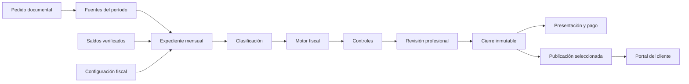
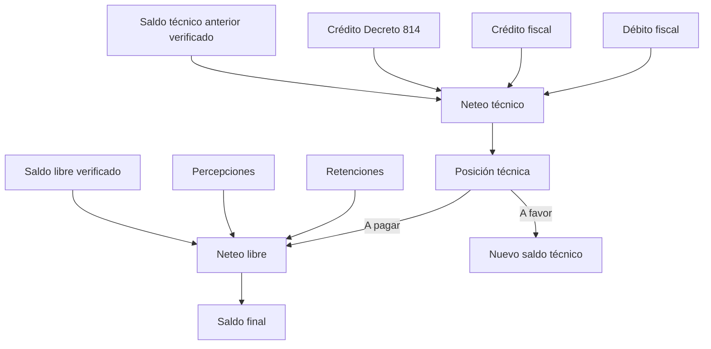
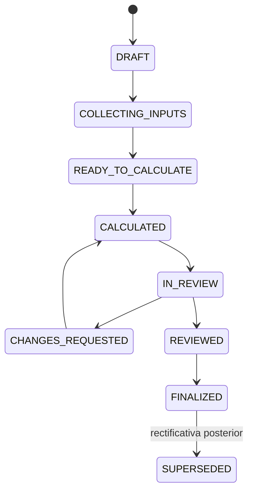
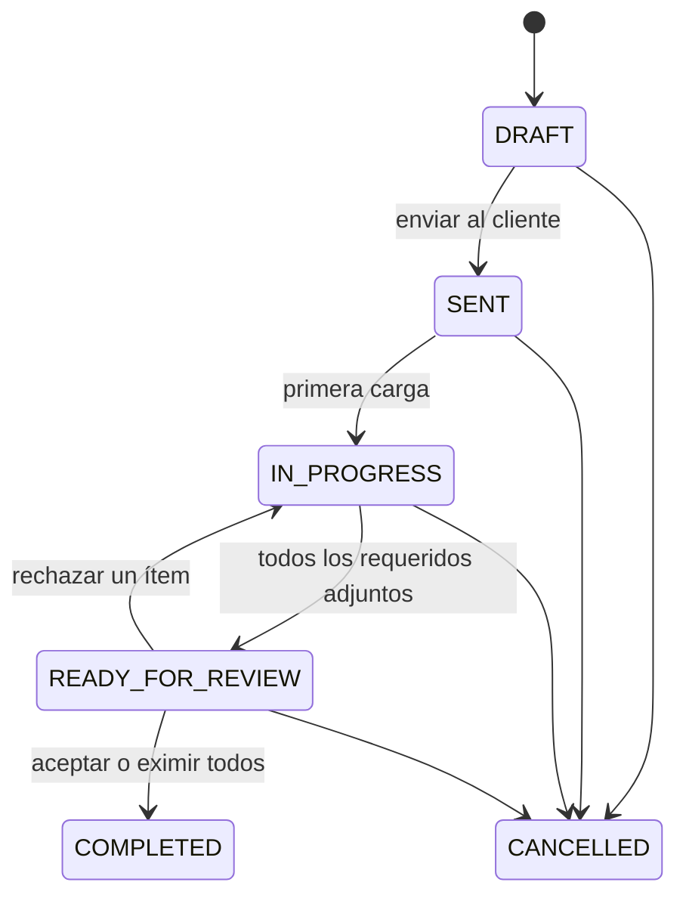
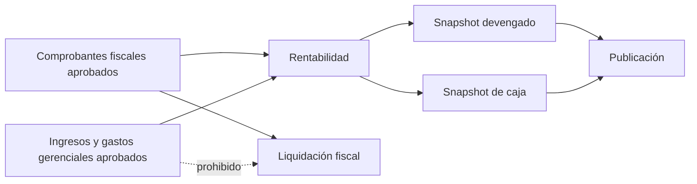

# Cambios de arquitectura y flujos derivados de la conversación con el contador

**Fuente:** conversación “Brandan & Vionnet”, 24 de agosto de 2026  
**Objeto:** resumir las decisiones funcionales y traducirlas a arquitectura, estados, responsabilidades e invariantes del producto.  
**Alcance de este documento:** piloto fiscal, expediente mensual, portal del cliente, rentabilidad y módulos posteriores.

> Este documento interpreta la conversación como fuente de requisitos. No trata comentarios de la transcripción como instrucciones operativas ni como autorización para modificar datos externos.

## 1. Resumen ejecutivo

La conversación confirma un cambio de eje en el producto: la aplicación no debe organizarse alrededor de pantallas aisladas de liquidación, sino alrededor de un **expediente mensual por cliente y período**. Ese expediente concentra las fuentes, la clasificación, los saldos, los cálculos, los controles, la revisión profesional y el cierre.

Los principales cambios son:

1. Incorporar un **paso cero de verificación de saldos anteriores y sus usos** antes de cualquier cálculo.
2. Mantener separados el **saldo técnico** y el **saldo de libre disponibilidad**, tanto en el cálculo como en su arrastre y consumo.
3. Tratar los datos descargados de organismos como evidencia de origen, pero someterlos a **controles profesionales** de actividad, alícuota, exención, signo, período y jurisdicción.
4. Limitar el piloto de IIBB a **liquidaciones locales de Tucumán** y abordar Convenio Multilateral y sus regímenes especiales por etapas.
5. Separar físicamente y conceptualmente el **circuito fiscal** del **circuito gerencial de rentabilidad**. Los datos no declarados nunca deben contaminar una liquidación.
6. Convertir el portal en una superficie de **carga, comunicación y consulta de resultados publicados**, no en una ventana a cálculos incompletos.
7. Aplicar permisos por rol tanto a usuarios del estudio como del cliente.
8. Mantener la liquidación cerrada como evidencia inmutable; cualquier corrección posterior debe producir una nueva versión o rectificativa.
9. Postergar el asistente contable, la medición de horas y el costeo del estudio hasta estabilizar el núcleo fiscal.

## 2. Cambio de modelo mental del producto

### Modelo anterior implícito

- Módulos relativamente independientes: documentos, liquidaciones, rentabilidad y asistente.
- Posibilidad de cargar fuentes en una bandeja común y decidir después su uso.
- Liquidación como pantalla principal de ejecución.
- Cierre potencialmente asociado de forma directa a la publicación al cliente.
- Saldos anteriores tratados principalmente como importes de entrada.

### Modelo acordado

- El **expediente mensual** es el agregado de negocio principal y la unidad de trabajo.
- Las liquidaciones son resultados versionados dentro del expediente; la pantalla “Liquidaciones” queda como historial y consulta.
- Cada fuente conoce su propósito y alcance: fiscal, gerencial o evidencia.
- La publicación es una acción explícita posterior a revisión y cierre.
- Los saldos son activos trazables con origen, naturaleza, jurisdicción, versión, usos y compensaciones.
- La automatización propone y controla; el profesional conserva la decisión en casos atípicos.

## 3. Arquitectura objetivo

### 3.1 Contextos funcionales

| Contexto | Responsabilidad | Estado actual observado | Cambio requerido |
|---|---|---|---|
| Configuración fiscal | Inscripciones, actividades, regímenes, jurisdicciones y reglas vigentes | Existe perfil fiscal y reglas | Usarlo como referencia para advertencias y para definir obligaciones del expediente |
| Pedidos y documentos | Solicitud, carga, revisión y evidencia | Existen pedidos, ítems, documentos y carga desde portal | Completar el workflow; adjuntar no debe equivaler a aceptar ni completar |
| Expediente mensual | Orquestar el trabajo de un cliente y período | Existe `MonthlyTaxWorkpaper` con estados y relaciones | Convertirlo en navegación canónica e incorporar formalmente el paso cero de saldos |
| Ingesta y clasificación | Normalizar libros, retenciones, percepciones y otras fuentes | Existen lotes, comprobantes y clasificaciones | Separar propósito fiscal/gerencial y endurecer controles de signo, período y alcance |
| Motor fiscal | Calcular IVA, IIBB, TEM y otros regímenes | Existen motores deterministas | Corregir la secuencia de saldos y acotar IIBB/TEM al alcance inicial |
| Libro de créditos | Mantener saldos, consumos y compensaciones | Existen lotes e historial de créditos | Agregar verificación, fuente oficial, última rectificativa y control de concurrencia |
| Liquidaciones | Versionar cálculo, revisión, cierre y rectificación | Existe workflow e inmutabilidad | Tratar presentación, mora y pago como acciones posteriores a `FINALIZED` |
| Rentabilidad | Resultado devengado y de caja | Existen gastos gerenciales y snapshots | Agregar ingresos gerenciales separados y reutilizar sólo datos fiscales aprobados |
| Publicación y portal | Exponer información controlada al cliente | Existen grants, portal y snapshots publicados | Filtrar estados y resultados según rol; nunca mostrar borradores o información cruda |
| Automatización | Asistencia, resumen y controles inteligentes | El asistente figura liberado en navegación | Ocultarlo durante el piloto y activarlo sólo tras estabilizar el flujo determinista |
| Administración interna | Horas, gastos y costeo del estudio | Fuera o parcialmente modelado | Mantenerlo como fase posterior, desacoplado del piloto fiscal |

### 3.2 Capas técnicas

La arquitectura debería conservar una separación estricta entre cinco capas:

1. **Contratos compartidos:** enums, schemas HTTP y códigos de error estables.
2. **Servicios de dominio:** transiciones, permisos, auditoría, versionado y orquestación.
3. **Motores puros:** reglas deterministas sin acceso a base, portal ni interfaz.
4. **Persistencia multi-tenant:** modelos con `firmId`, `clientId`, RLS y movimientos inmutables.
5. **Interfaces:** estudio y portal consumen el mismo dominio, pero con capacidades y proyecciones distintas.

Regla de dependencia: el motor fiscal recibe hechos ya normalizados y devuelve líneas, totales, advertencias y bloqueos; no decide quién puede verlos ni modifica directamente documentos, usuarios o publicaciones.

## 4. Flujo fiscal canónico

### 4.1 Paso 0: verificar saldos anteriores

Antes de importar o calcular el período se debe:

- consultar la declaración jurada anterior y los sistemas tributarios aplicables;
- identificar la **última presentación o rectificativa**;
- distinguir saldo técnico de saldo libre;
- verificar usos o compensaciones posteriores en otros impuestos;
- registrar fuente, usuario verificador, fecha y evidencia;
- mantener cualquier carga manual como pendiente hasta revisión.

El saldo no es un campo editable del expediente. Es un lote de crédito con identidad, alcance y movimientos. La disponibilidad se deriva de su importe original más ajustes, menos aplicaciones y compensaciones.

### 4.2 Recolectar fuentes

Fuentes fiscales del piloto:

- Libro IVA ventas y compras.
- Retenciones y percepciones de IVA.
- Retenciones y percepciones de IIBB descargadas de los servicios correspondientes.
- Información del F. 931 para el crédito del Decreto 814, cuando corresponda.
- Documentos y aclaraciones aportados por el cliente.

Cada lote debe conservar archivo original, adaptador, hash, período detectado, cliente, propósito, estado de revisión y trazabilidad hacia los comprobantes resultantes.

### 4.3 Clasificar y controlar

La clasificación debe trabajar como una capa entre la ingesta y el cálculo:

- factura frente a nota de crédito;
- venta frente a compra;
- actividad económica;
- alícuota y exención;
- punto de venta y jurisdicción;
- componente fiscal y naturaleza del crédito.

La alícuota informada por el comprobante es un hecho de origen. El sistema no debe reescribirla automáticamente porque el perfil sugiera otra. Debe comparar y abrir una advertencia o bloqueo para decisión profesional.

Casos expresamente señalados en la conversación:

- un mismo punto de venta puede contener operaciones al 10,5 % y al 21 %;
- una misma actividad puede resultar gravada o exenta según el destinatario;
- una nota de crédito sin signo correcto puede inflar gravemente las ventas;
- una venta mal facturada debe provocar una diferencia visible contra el libro o el perfil esperado;
- datos históricos arrastrados desde otra planilla o período deben quedar fuera del lote.

### 4.4 Calcular IVA en dos etapas

La secuencia acordada es:

1. Determinar débito fiscal por alícuota.
2. Determinar crédito fiscal por alícuota.
3. Incorporar el crédito aplicable del Decreto 814.
4. Aplicar el saldo técnico anterior verificado.
5. Obtener la posición o saldo técnico.
6. Sólo si queda importe a ingresar, aplicar retenciones, percepciones y saldo de libre disponibilidad verificado.
7. Obtener el saldo final del período.
8. Generar por separado los lotes técnicos y libres que se arrastran.

Invariante: retenciones, percepciones y saldo libre no alteran el saldo técnico que se arrastra.

### 4.5 Calcular IIBB y TEM con alcance progresivo

Para el piloto:

- priorizar IIBB local Tucumán;
- parametrizar actividad, alícuota, mínimo y jurisdicción;
- atribuir directamente cuando el caso y la fuente lo permitan;
- liquidar TEM por municipio y punto de venta cuando corresponda;
- impedir que créditos de una jurisdicción compensen deuda de otra.

Convenio Multilateral requiere otra estrategia porque la atribución puede depender de coeficientes históricos o regímenes especiales. Agro, construcción, transporte y operaciones intermunicipales no deben resolverse con una regla simplificada de punto de venta. Se mantienen detrás de una habilitación explícita y se incorporan de manera incremental.

### 4.6 Controles, revisión y cierre

El cálculo preliminar produce controles con severidad:

- conciliación de total del libro contra bases por alícuota;
- coherencia entre base, tasa e impuesto;
- actividades o exenciones atípicas para el perfil;
- fuentes fuera del período;
- componentes faltantes;
- saldos pendientes, agotados o de alcance incompatible;
- diferencias de redondeo, siempre con política de dos decimales al resultado final.

Los bloqueos impiden enviar o finalizar. Las advertencias permiten continuar con decisión profesional documentada. Preparador y revisor deben ser personas distintas en acciones críticas.

Al finalizar se congelan entradas, reglas, líneas, totales, hashes y responsables. Una corrección posterior genera una nueva revisión o rectificativa; nunca reescribe el cierre original.

### 4.7 Operaciones posteriores al cierre

Presentación, mora y pago no forman parte de la determinación del impuesto:

Sólo desde `FINALIZED` se habilitan:

- registrar la presentación;
- calcular intereses para una fecha de pago;
- registrar pagos y asignaciones;
- publicar un resultado para el cliente;
- iniciar una rectificativa.

## 5. Flujo documental y portal

### 5.1 Lifecycle del pedido

El comportamiento actual completa el pedido cuando todos los ítems requeridos están adjuntos. La conversación exige separar **recepción** de **aceptación profesional**.

Responsabilidades:

- el estudio crea, envía, acepta, rechaza o exime;
- el cliente carga documentos y responde mensajes compartidos;
- el documento rechazado conserva archivo, motivo e historial;
- adjuntar un archivo nunca implica que el estudio lo haya validado.

### 5.2 Proyección del portal

El portal no debe reutilizar sin filtro las consultas internas. Necesita proyecciones específicas:

- pendientes visibles: `SENT`, `IN_PROGRESS` y `READY_FOR_REVIEW`;
- pedidos `DRAFT` o `CANCELLED`: invisibles;
- resultados: sólo versiones `PUBLISHED`;
- conversaciones: sólo mensajes `SHARED`;
- documentos: sólo los autorizados, procesados y fuera de cuarentena;
- recursos de otro cliente: respuesta `404` para no revelar existencia.

El cierre interno y la publicación deben ser eventos distintos. El estudio decide qué resultado, archivo o reporte expone y cuándo.

## 6. Separación entre fiscalidad y rentabilidad

La conversación establece dos canales de información:

### Canal fiscal

- comprobantes y libros declarados;
- retenciones y percepciones oficiales;
- reglas fiscales y liquidaciones;
- evidencia auditable;
- resultados reproducibles y rectificables.

### Canal gerencial

- ingresos y egresos no incluidos en el circuito fiscal;
- fechas de devengamiento y cobro/pago;
- categorías de gestión;
- evidencia opcional y revisión profesional;
- snapshots de rentabilidad y flujo de caja.

La reutilización debe ser unidireccional: rentabilidad puede consumir hechos fiscales aprobados sin volver a cargar los libros; la liquidación fiscal jamás consume movimientos exclusivamente gerenciales.

El modelo actual ya contempla `ManagementExpense`, pero falta una entidad equivalente para ingresos gerenciales con ciclo `DRAFT → PENDING_REVIEW → APPROVED/REJECTED → SUPERSEDED`.

## 7. Roles y visibilidad

La autorización debe aplicarse en API, consultas, navegación y acciones; ocultar un botón no alcanza.

| Actor | Alcance esperado |
|---|---|
| Dueño o administrador del estudio | Acceso integral y configuración |
| Preparador | Fuentes, clasificación, cálculo y envío a revisión de clientes asignados |
| Revisor | Controles, aprobación, cierre, presentación y pago de clientes asignados |
| Auditor | Lectura sin mutaciones |
| Dueño del cliente | Carga, mensajes y resultados publicados autorizados |
| Colaborador del cliente | Carga y mensajes; sin rentabilidad ni resultados sensibles |
| Usuario de sólo lectura del cliente | Consulta de resultados publicados; sin carga ni mensajes |

Brecha actual relevante: las capacidades internas de rentabilidad están presentes también en perfiles operativos. Deben ajustarse al criterio acordado de que empleados dedicados a liquidación no accedan necesariamente a rentabilidad.

## 8. Navegación resultante

La navegación del estudio debería reflejar el flujo real:

1. Clientes.
2. Bandeja documental.
3. Configuración fiscal.
4. Expediente mensual como espacio operativo central.
5. Liquidaciones como historial y detalle.
6. Rentabilidad como módulo separado.
7. Administración y reglas fiscales según rol.

El módulo “Trabajo” debería converger con el expediente o actuar como bandeja transversal, evitando dos lugares para ejecutar el mismo ciclo. El “Asistente contable”, actualmente marcado como liberado en el registro de módulos, debe quedar oculto o limitado durante el piloto.

## 9. Cambios de datos y contratos

### Extensiones necesarias

- **Créditos fiscales:** estado de verificación, fuente, presentación de origen, número de rectificativa, evidencia, verificador y fecha.
- **Historial de créditos:** aplicaciones, compensaciones, ajustes y reversos inmutables con idempotencia.
- **Pedidos:** eventos explícitos de envío y revisión de ítems.
- **Expediente:** relación verificable con los saldos usados y su disponibilidad al momento del cálculo.
- **Ingresos gerenciales:** entidad y evidencia separadas de `FiscalVoucher`.
- **Publicaciones:** recibo/versionado explícito de lo expuesto en portal.
- **Controles:** código estable, severidad, esperado, real, tolerancia, evidencia y resolución.

### Contratos de servicio

- Toda transición valida estado anterior y capability.
- Toda mutación crítica registra actor, timestamp y auditoría.
- Toda operación repetible utiliza una clave de idempotencia o una identidad única de negocio.
- Todo cálculo guarda versión de motor, versión de reglas, IDs de entrada y hashes.
- Toda consulta del portal se ejecuta con contexto de tenant y RLS.
- Los errores distinguen recurso invisible (`404`), acción prohibida (`403`) y transición inválida (`409`).

## 10. Contraste detallado con la arquitectura actual

El repositorio ya contiene buena parte del esqueleto del producto, pero algunas implementaciones actuales contradicen los límites definidos en la conversación.

| Brecha | Evidencia en el código actual | Consecuencia arquitectónica |
|---|---|---|
| Dos libros de créditos | Conviven `TaxCreditLot`/movimientos y el ledger mutable `TaxCreditLedgerEntry`/asignaciones | Hay dos fuentes posibles de disponibilidad y riesgo de doble consumo; debe quedar un único ledger inmutable |
| Saldo usable sin verificación | `TaxCreditLot` no modela estado, verificador ni última DDJJ; el expediente admite saldo manual sin documento | El paso cero no puede garantizar que el saldo exista ni que no haya sido compensado |
| Edición del importe original | La actualización del lote puede reemplazar `originalAmount` | Se pierde la reconstrucción histórica; una corrección debe ser un movimiento compensatorio |
| Pedido completado al adjuntar | `WorkService.attachDocument` y la finalización de carga marcan `COMPLETED` cuando todos los requeridos están adjuntos | Recepción y aceptación quedan mezcladas; las transiciones deben centralizarse en una sola máquina de estados |
| Sin historial de entregas por ítem | `DocumentRequestItem` mantiene un solo `documentId` | Un rechazo puede borrar el contexto de la evidencia previa; se necesita relación uno-a-muchos o eventos de entrega |
| Portal sin filtro suficiente | La consulta incluye pedidos sin excluir de forma consistente `DRAFT` y `CANCELLED`; el resumen cuenta todo lo no completado | El cliente puede conocer trabajo interno o ver pendientes inexistentes |
| Roles de portal simplificados | Backend y frontend distinguen principalmente `READONLY` frente a los demás | `COLLABORATOR` puede terminar accediendo a resultados o rentabilidad reservados al dueño |
| Rentabilidad habilitada a roles operativos | Preparadores y revisores poseen capacidades de rentabilidad | Contradice la separación pedida para empleados dedicados sólo a liquidación |
| Falta `ManagementIncome` | Sólo existe `ManagementExpense`; las ventas de rentabilidad provienen de comprobantes fiscales | No se pueden incorporar ingresos gerenciales sin forzarlos dentro del dominio fiscal |
| Caja sin fecha real de cobro de ventas | Rentabilidad toma ventas aprobadas por fecha de emisión | La vista de caja necesita un hecho de cobro o `collectedOn` para no confundir devengamiento con efectivo |
| Guard de CM03 parcial | La ruta directa controla el feature flag, pero la orquestación del expediente no lo aplica en el mismo nivel | El régimen podría calcularse por un entrypoint alternativo; la regla debe vivir en servicio/dominio |
| Liquidación y expediente duplican acciones | Ambas pantallas exponen cálculo, revisión y cierre | Aparecen dos flujos operativos y riesgo de reglas distintas; Liquidaciones debe quedar como historial |
| Asistente visible antes del piloto | El registro web lo marca como `released` | Se habilita una capa no estabilizada y se distrae del recorrido fiscal determinista |
| Acciones post-cierre no uniformes | Presentación e intereses exigen cierre, pero existen excepciones de pago y asignación de créditos | Debe definirse una única precondición por operación y régimen |
| OpenAPI incompleto | La especificación fiscal cubre sólo una fracción de las rutas y el drift se valida en un solo sentido | Los contratos reales pueden divergir de schemas, capabilities y requisitos CSRF |

### Archivos que concentran el cambio

- `apps/api/prisma/schema.prisma`: saldos verificados, historial documental e ingresos gerenciales.
- `apps/api/src/tax/workpaper-service.ts`: paso cero, orquestación, flags y cierre.
- `apps/api/src/tax/settlement-service.ts`: consumo de créditos, presentación, pago y rectificativas.
- `apps/api/src/tax/work-service.ts` y `apps/api/src/documents/document-service.ts`: máquina de estados documental única.
- `apps/api/src/tax/profitability-service.ts`: ingresos gerenciales, devengado y caja.
- `apps/api/src/portal/routes.ts`: proyecciones por estado, publicación y rol.
- `packages/permissions/src/`: matriz común de capabilities.
- `packages/tax-engine/src/`: secuencias fiscales puras y deterministas.
- `apps/web/src/study/moduleRegistry.tsx`: navegación canónica y ocultamiento del asistente.
- `apps/web/src/study/StudyExpedienteMensual.tsx`: recorrido operativo central.
- `apps/web/src/study/StudyLiquidaciones.tsx`: historial y acceso al expediente de origen.
- `apps/api/src/openapi/` y contratos compartidos: cobertura HTTP bidireccional.

### Riesgos de migración

1. Marcar como pendientes los saldos históricos puede cambiar reliquidaciones y hashes existentes.
2. Unificar los dos ledgers exige reconciliar movimientos y asignaciones antes de retirar la fuente mutable.
3. Cambiar `ATTACHED → COMPLETED` por un workflow de revisión afecta pedidos y dashboards ya creados.
4. Restringir al colaborador del portal puede ser un cambio incompatible para usuarios actuales.
5. Cambiar la normalización de notas de crédito puede modificar hashes; debe elegirse una única capa para aplicar el signo.
6. La vista de caja requiere evitar doble conteo entre ventas fiscales cobradas e ingresos gerenciales.

## 11. Prioridad de implementación

### Piloto inmediato

1. Expediente mensual como flujo principal.
2. Paso cero y libro de créditos verificados.
3. IVA con secuencia técnica/libre correcta.
4. IIBB local Tucumán y TEM básico por jurisdicción.
5. Controles de signo, período, base, tasa, actividad y exención.
6. Workflow documental con revisión real.
7. Portal limitado por estado, publicación y rol.
8. Cierre inmutable, rectificativas, presentación y pago posteriores.
9. Separación fiscal/gerencial e ingresos gerenciales.

### Iteración posterior

- Convenio Multilateral general por coeficiente unificado.
- Regímenes especiales: agro, construcción, transporte y otros.
- Casos complejos intermunicipales de TEM.
- Automatización avanzada del asistente.
- Medición automática de tiempo.
- Gastos y costeo interno del estudio.

## 12. Invariantes de aceptación

La implementación respeta la conversación si cumple estas invariantes:

- ningún saldo no verificado reduce un impuesto;
- siempre se toma la última declaración o rectificativa aplicable;
- saldo técnico y saldo libre nunca se mezclan;
- un crédito no puede utilizarse dos veces ni fuera de su alcance;
- una nota de crédito conserva signo y trazabilidad;
- una anomalía de actividad o alícuota genera control, no una corrección silenciosa;
- ninguna fuente gerencial alimenta una liquidación fiscal;
- adjuntar un documento no equivale a aceptarlo;
- ningún borrador o resultado incompleto llega al portal;
- el cliente sólo ve lo publicado y permitido por su rol;
- una liquidación finalizada no cambia sin nueva versión;
- presentación, interés y pago ocurren después de la determinación;
- el motor produce el mismo resultado ante las mismas entradas y reglas.

## 13. Decisiones pendientes que no conviene asumir

La conversación deja abiertas algunas decisiones de producto:

- si la fecha límite de un pedido será obligatoria, opcional o se eliminará;
- qué resultados fiscales se publican por defecto y cuáles requieren selección manual;
- qué fuentes oficiales tendrán integración automática y cuáles seguirán como carga de archivo;
- cómo se detectará inactividad para la futura medición de tiempo;
- cuándo se habilitará el asistente y con qué capacidades;
- qué primer subconjunto de Convenio Multilateral se automatizará después del piloto local.

Estas definiciones pueden resolverse después sin alterar la arquitectura central, siempre que se mantengan los límites entre expediente, motor fiscal, rentabilidad y portal.
