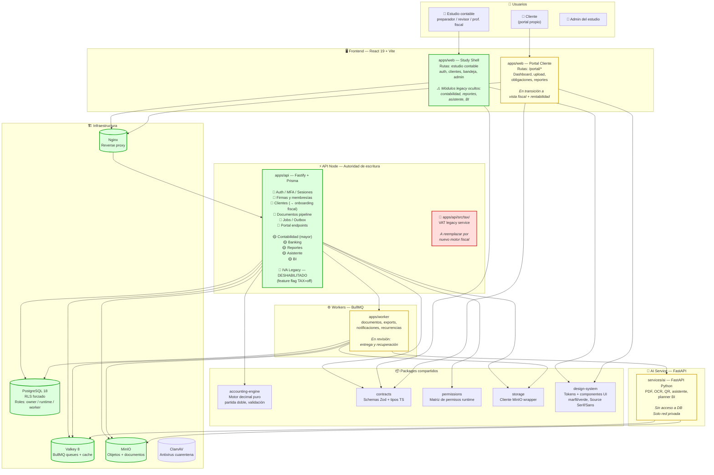
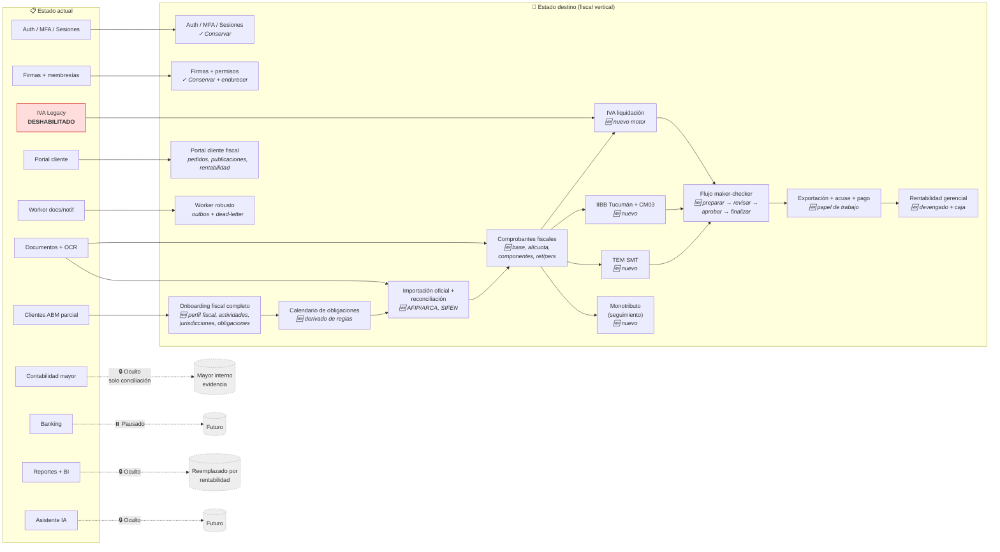
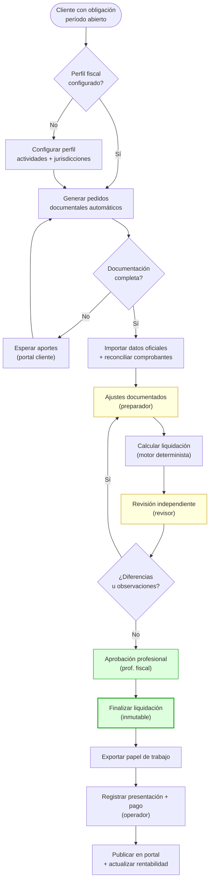

# Arquitectura de Contable — Diagrama vivo

> Este diagrama se actualiza con cada cambio arquitectónico significativo.
> Refleja el estado **actual** y la **transición** hacia el nuevo diseño fiscal.

---

## 1. Vista general — Contenedores (estado actual + transición)

---

## 2. Mapa de transición — Módulos

---

## 3. Flujo de liquidación (target)

---

## 4. Principios arquitectónicos clave

| Principio | Descripción |
|-----------|-------------|
| **Autoridad de escritura** | Solo Node/Fastify escribe. IA nunca crea asientos ni finaliza liquidaciones. |
| **RLS obligatorio** | Runtime nunca es owner de PostgreSQL. Políticas forzadas por estudio/cliente. |
| **Outbox durable** | Intención en PostgreSQL; worker reclama con lease. Dead-letter tras 10 intentos. |
| **Maker-checker** | Quien prepara no revisa ni finaliza. Historial inmutable. |
| **Feature flags** | Módulos incompletos ocultos por flag server-side. Sin pantallas decorativas. |
| **Sin credenciales fiscales** | No se almacenan claves ARCA/COMARB. El contador presenta manualmente. |

---

> **Próxima actualización:** cuando un nuevo módulo fiscal (IVA, IIBB, TEM) pase su puerta y se active.