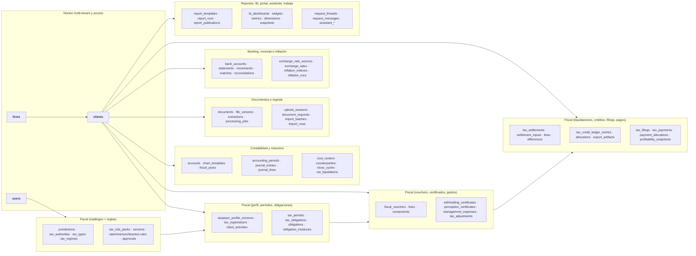
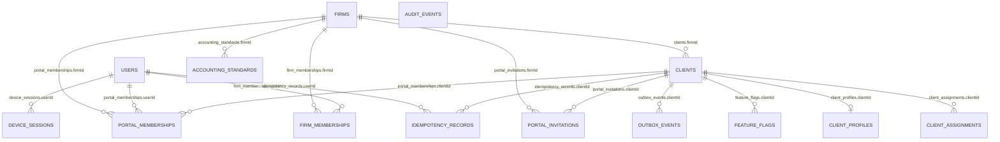
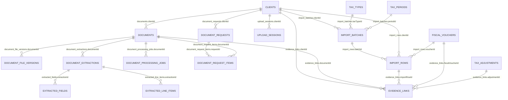
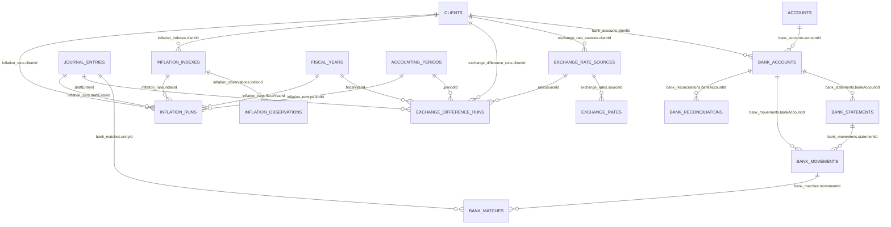
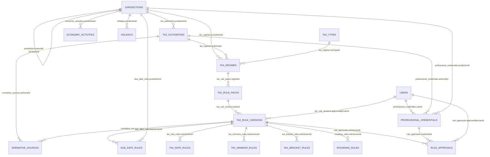
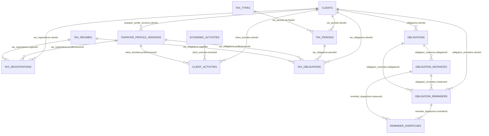

# Esquema de la Base de Datos — contable (PostgreSQL real)

> **Generado el:** 2026-09-03
> **Base consultada:** `contable@localhost:5432` (esquema `public`)
> **Fuente:** consulta directa a `information_schema` (`pg_tables` + `table_constraints` / `key_column_usage`)
> **Totales:** 111 tablas de negocio (+ `_prisma_migrations`) · 222 foreign keys

Este documento refleja **exactamente** el estado real de la base de datos local. Si el esquema cambia (nuevas migraciones), regenerar el documento es preferible a editarlo a mano.

> ⚠️ **Nota de legibilidad:** con 111 tablas, un único diagrama `erDiagram` sería ilegible en la mayoría de los renderizadores de Mermaid. Por eso el documento se organiza en:
> 1. Un **mapa de dominios** (vista general).
> 2. **Diagramas ER por dominio funcional** (cada uno autocontenido; las tablas del núcleo se repiten donde aportan contexto).
> 3. Un **apéndice** con las 222 foreign keys completas en formato tabla.

---

## Mapa de dominios

---

## 1. Núcleo multi-tenant y acceso

Tablas: `firms`, `users`, `firm_memberships`, `clients`, `client_assignments`, `client_profiles`, `device_sessions`, `portal_invitations`, `portal_memberships`, `feature_flags`, `audit_events`, `idempotency_records`, `outbox_events`.

Notas:
- `client_profiles` es **1 a 1** con `clients` (`||--o|`).
- `audit_events` no tiene foreign keys (tabla de auditoría deliberadamente plana).
- `outbox_events` se accede vía funciones `SECURITY DEFINER` (`app_claim_outbox`, etc.), no por SQL directo.
- `accounting_standards` es el catálogo de normas contables **por estudio**: se administra desde Administración y la ficha del cliente selecciona de él (sin texto libre). No tiene valores precargados; `client_profiles.accountingStandard` conserva datos legacy en lectura y sólo se valida contra el catálogo al guardar.

---

## 2. Contabilidad y maestros

Tablas: `chart_templates`, `accounts`, `fiscal_years`, `accounting_periods`, `journal_entries`, `journal_lines`, `cost_centers`, `counterparties`, `onboarding_checklists`, `close_cycles`, `close_work_items`, `vat_liquidations`, `vat_rules`, `_VatLiquidationToVatRule` (M:N implícita de Prisma).

```mermaid
erDiagram
    %% Plan de cuentas
    CLIENTS ||--o{ CHART_TEMPLATES : "chart_templates.clientId"
    CLIENTS ||--o{ ACCOUNTS : "accounts.clientId"
    CHART_TEMPLATES ||--o{ ACCOUNTS : "accounts.chartVersionId"

    %% Ejercicio y períodos
    CLIENTS ||--o{ FISCAL_YEARS : "fiscal_years.clientId"
    FISCAL_YEARS ||--o{ ACCOUNTING_PERIODS : "accounting_periods.fiscalYearId"

    %% Diario
    CLIENTS ||--o{ JOURNAL_ENTRIES : "journal_entries.clientId"
    FISCAL_YEARS ||--o{ JOURNAL_ENTRIES : "journal_entries.fiscalYearId"
    ACCOUNTING_PERIODS ||--o{ JOURNAL_ENTRIES : "journal_entries.periodId"
    USERS ||--o{ JOURNAL_ENTRIES : "journal_entries.preparedByUserId"
    USERS ||--o{ JOURNAL_ENTRIES : "journal_entries.reviewedByUserId"
    USERS ||--o{ JOURNAL_ENTRIES : "journal_entries.postedByUserId"
    JOURNAL_ENTRIES ||--o{ JOURNAL_LINES : "journal_lines.entryId"
    ACCOUNTS ||--o{ JOURNAL_LINES : "journal_lines.accountId"

    %% Maestros auxiliares
    CLIENTS ||--o{ COST_CENTERS : "cost_centers.clientId"
    CLIENTS ||--o{ COUNTERPARTIES : "counterparties.clientId"
    CLIENTS ||--o{ ONBOARDING_CHECKLISTS : "onboarding_checklists.clientId"

    %% Cierres
    CLIENTS ||--o{ CLOSE_CYCLES : "close_cycles.clientId"
    FISCAL_YEARS ||--o{ CLOSE_CYCLES : "close_cycles.fiscalYearId"
    ACCOUNTING_PERIODS ||--o{ CLOSE_CYCLES : "close_cycles.periodId"
    CLOSE_CYCLES ||--o{ CLOSE_WORK_ITEMS : "close_work_items.cycleId"
    USERS ||--o{ CLOSE_WORK_ITEMS : "close_work_items.assigneeUserId"
    USERS ||--o{ CLOSE_WORK_ITEMS : "close_work_items.completedByUserId"

    %% IVA legacy (v1, bloqueado por flag)
    CLIENTS ||--o{ VAT_LIQUIDATIONS : "vat_liquidations.clientId"
    ACCOUNTING_PERIODS ||--o{ VAT_LIQUIDATIONS : "vat_liquidations.periodId"
    USERS ||--o{ VAT_LIQUIDATIONS : "vat_liquidations.preparedByUserId"
    USERS ||--o{ VAT_LIQUIDATIONS : "vat_liquidations.reviewedByUserId"
    CLIENTS ||--o{ VAT_RULES : "vat_rules.clientId"
    VAT_LIQUIDATIONS ||--o{ VAT_LIQUIDATION_VAT_RULES : "relación M:N (física _VatLiquidationToVatRule)"
    VAT_RULES ||--o{ VAT_LIQUIDATION_VAT_RULES : "relación M:N (física _VatLiquidationToVatRule)"
```

---

## 3. Documentos, ingesta y procesamiento

Tablas: `documents`, `document_file_versions`, `document_extractions`, `extracted_fields`, `extracted_line_items`, `document_processing_jobs`, `upload_sessions`, `document_requests`, `document_request_items`, `import_batches`, `import_rows`, `evidence_links`.

---

## 4. Banking, moneda e inflación

Tablas: `bank_accounts`, `bank_statements`, `bank_movements`, `bank_matches`, `bank_reconciliations`, `exchange_rate_sources`, `exchange_rates`, `exchange_difference_runs`, `inflation_indexes`, `inflation_observations`, `inflation_runs`.

---

## 5. Fiscal — catálogos y reglas

Tablas: `jurisdictions`, `tax_authorities`, `tax_types`, `tax_regimes`, `economic_activities`, `holidays`, `due_date_rules`, `professional_credentials`, `normative_sources`, `tax_rule_packs`, `tax_rule_versions`, `tax_rate_rules`, `tax_minimum_rules`, `tax_bracket_rules`, `rounding_rules`, `rule_approvals`.

> Las tablas de catálogos de firma NO tienen columna `firmId` (compartidas entre firmas); el aislamiento es por policy RLS + membresía, no por columna.

---

## 6. Fiscal — perfil, períodos y obligaciones

Tablas: `taxpayer_profile_versions`, `tax_registrations`, `client_activities`, `tax_periods`, `tax_obligations`, `obligations`, `obligation_instances`, `obligation_reminders`, `reminder_dispatches`.

---

## 7. Fiscal — vouchers, certificados y gastos

Tablas: `fiscal_vouchers`, `fiscal_voucher_lines`, `fiscal_components`, `withholding_certificates`, `perception_certificates`, `management_expenses`, `expense_evidence`, `tax_treatment_decisions`, `tax_adjustments`.

```mermaid
erDiagram
    %% Comprobantes fiscales
    CLIENTS ||--o{ FISCAL_VOUCHERS : "fiscal_vouchers.clientId"
    DOCUMENTS ||--o{ FISCAL_VOUCHERS : "fiscal_vouchers.documentId"
    TAX_PERIODS ||--o{ FISCAL_VOUCHERS : "fiscal_vouchers.periodId"
    FISCAL_VOUCHERS ||--o{ FISCAL_VOUCHERS : "fiscal_vouchers.duplicateOfId (duplicado)"
    FISCAL_VOUCHERS ||--o{ FISCAL_VOUCHER_LINES : "fiscal_voucher_lines.voucherId"
    CLIENTS ||--o{ FISCAL_VOUCHER_LINES : "fiscal_voucher_lines.clientId"
    FISCAL_VOUCHERS ||--o{ FISCAL_COMPONENTS : "fiscal_components.voucherId"
    CLIENTS ||--o{ FISCAL_COMPONENTS : "fiscal_components.clientId"

    %% Certificados de retención / percepción
    CLIENTS ||--o{ WITHHOLDING_CERTIFICATES : "withholding_certificates.clientId"
    CLIENTS ||--o{ PERCEPTION_CERTIFICATES : "perception_certificates.clientId"

    %% Gastos de gestión
    CLIENTS ||--o{ MANAGEMENT_EXPENSES : "management_expenses.clientId"
    CLIENTS ||--o{ EXPENSE_EVIDENCE : "expense_evidence.clientId"
    DOCUMENTS ||--o{ EXPENSE_EVIDENCE : "expense_evidence.documentId"
    MANAGEMENT_EXPENSES ||--o{ EXPENSE_EVIDENCE : "expense_evidence.expenseId"
    MANAGEMENT_EXPENSES ||--o{ TAX_TREATMENT_DECISIONS : "tax_treatment_decisions.expenseId"
    CLIENTS ||--o{ TAX_TREATMENT_DECISIONS : "tax_treatment_decisions.clientId"
    USERS ||--o{ TAX_TREATMENT_DECISIONS : "tax_treatment_decisions.decidedByUserId"
    TAX_RULE_VERSIONS ||--o{ TAX_TREATMENT_DECISIONS : "tax_treatment_decisions.ruleVersionId"

    %% Ajustes
    CLIENTS ||--o{ TAX_ADJUSTMENTS : "tax_adjustments.clientId"
    TAX_PERIODS ||--o{ TAX_ADJUSTMENTS : "tax_adjustments.periodId"
    TAX_RULE_VERSIONS ||--o{ TAX_ADJUSTMENTS : "tax_adjustments.ruleVersionId"
    TAX_TREATMENT_DECISIONS ||--o{ TAX_ADJUSTMENTS : "tax_adjustments.treatmentDecisionId"
    FISCAL_VOUCHERS ||--o{ TAX_ADJUSTMENTS : "tax_adjustments.voucherId"
```

---

## 8. Fiscal — liquidaciones, créditos, filings y pagos

Tablas: `tax_settlements`, `settlement_inputs`, `tax_settlement_lines`, `tax_differences`, `tax_credit_ledger_entries`, `tax_credit_allocations`, `tax_export_artifacts`, `tax_filings`, `tax_payments`, `payment_allocations`, `profitability_snapshots`.

```mermaid
erDiagram
    %% Liquidaciones
    CLIENTS ||--o{ TAX_SETTLEMENTS : "tax_settlements.clientId"
    TAX_PERIODS ||--o{ TAX_SETTLEMENTS : "tax_settlements.periodId"
    TAX_TYPES ||--o{ TAX_SETTLEMENTS : "tax_settlements.taxTypeId"
    TAX_REGIMES ||--o{ TAX_SETTLEMENTS : "tax_settlements.regimeId"
    JURISDICTIONS ||--o{ TAX_SETTLEMENTS : "tax_settlements.jurisdictionId"
    USERS ||--o{ TAX_SETTLEMENTS : "preparedByUserId"
    USERS ||--o{ TAX_SETTLEMENTS : "reviewedByUserId"
    USERS ||--o{ TAX_SETTLEMENTS : "finalizedByUserId"
    TAX_SETTLEMENTS ||--o{ TAX_SETTLEMENTS : "supersedesId (rectificación)"
    TAX_SETTLEMENTS ||--o{ SETTLEMENT_INPUTS : "settlement_inputs.settlementId"
    CLIENTS ||--o{ SETTLEMENT_INPUTS : "settlement_inputs.clientId"
    TAX_SETTLEMENTS ||--o{ TAX_SETTLEMENT_LINES : "tax_settlement_lines.settlementId"
    CLIENTS ||--o{ TAX_SETTLEMENT_LINES : "tax_settlement_lines.clientId"
    TAX_SETTLEMENTS ||--o{ TAX_DIFFERENCES : "tax_differences.settlementId"
    CLIENTS ||--o{ TAX_DIFFERENCES : "tax_differences.clientId"

    %% Libro de créditos (inmutable)
    CLIENTS ||--o{ TAX_CREDIT_LEDGER_ENTRIES : "tax_credit_ledger_entries.clientId"
    TAX_TYPES ||--o{ TAX_CREDIT_LEDGER_ENTRIES : "tax_credit_ledger_entries.taxTypeId"
    TAX_CREDIT_LEDGER_ENTRIES ||--o{ TAX_CREDIT_ALLOCATIONS : "tax_credit_allocations.creditEntryId"
    TAX_SETTLEMENTS ||--o{ TAX_CREDIT_ALLOCATIONS : "tax_credit_allocations.settlementId"
    CLIENTS ||--o{ TAX_CREDIT_ALLOCATIONS : "tax_credit_allocations.clientId"

    %% Artefactos de exportación (papel de trabajo)
    CLIENTS ||--o{ TAX_EXPORT_ARTIFACTS : "tax_export_artifacts.clientId"
    TAX_SETTLEMENTS ||--o{ TAX_EXPORT_ARTIFACTS : "tax_export_artifacts.settlementId"

    %% Presentaciones y pagos
    CLIENTS ||--o{ TAX_FILINGS : "tax_filings.clientId"
    TAX_OBLIGATIONS ||--o{ TAX_FILINGS : "tax_filings.obligationId"
    TAX_SETTLEMENTS ||--o{ TAX_FILINGS : "tax_filings.settlementId"
    DOCUMENTS ||--o{ TAX_FILINGS : "tax_filings.evidenceDocumentId (acuse)"
    CLIENTS ||--o{ TAX_PAYMENTS : "tax_payments.clientId"
    TAX_OBLIGATIONS ||--o{ TAX_PAYMENTS : "tax_payments.obligationId"
    TAX_SETTLEMENTS ||--o{ TAX_PAYMENTS : "tax_payments.settlementId"
    TAX_PAYMENTS ||--o{ PAYMENT_ALLOCATIONS : "payment_allocations.paymentId"
    TAX_OBLIGATIONS ||--o{ PAYMENT_ALLOCATIONS : "payment_allocations.obligationId"
    CLIENTS ||--o{ PAYMENT_ALLOCATIONS : "payment_allocations.clientId"

    %% Rentabilidad (como la anterior relacionada por cliente+pregunta)
    CLIENTS ||--o{ PROFITABILITY_SNAPSHOTS : "profitability_snapshots.clientId"
    TAX_PERIODS ||--o{ PROFITABILITY_SNAPSHOTS : "profitability_snapshots.periodId"
```

> `profitability_snapshots` además tiene una FOREIGN KEY **compuesta** `(clientId, firmId) → clients(id, firmId)`, que PostgreSQL reporta en `information_schema` como 5 restricciones simples superpuestas.

---

## 9. Reportes, BI, portal, asistente y trabajo

Tablas: `report_templates`, `report_template_lines`, `report_runs`, `report_publications`, `bi_dashboards`, `bi_widgets`, `bi_metrics`, `bi_dimensions`, `bi_snapshots`, `request_threads`, `request_messages`, `assistant_conversations`, `assistant_turns`, `assistant_evidence`, `assistant_feedback`, `assistant_usage`.

```mermaid
erDiagram
    %% Reportes
    CLIENTS ||--o{ REPORT_TEMPLATES : "report_templates.clientId"
    REPORT_TEMPLATES ||--o{ REPORT_TEMPLATE_LINES : "report_template_lines.templateId"
    CLIENTS ||--o{ REPORT_RUNS : "report_runs.clientId"
    REPORT_TEMPLATES ||--o{ REPORT_RUNS : "report_runs.templateId"
    USERS ||--o{ REPORT_RUNS : "createdByUserId"
    USERS ||--o{ REPORT_RUNS : "publishedByUserId"
    USERS ||--o{ REPORT_RUNS : "revokedByUserId"
    CLIENTS ||--o{ REPORT_PUBLICATIONS : "report_publications.clientId"
    REPORT_RUNS ||--o{ REPORT_PUBLICATIONS : "report_publications.runId"
    USERS ||--o{ REPORT_PUBLICATIONS : "publishedByUserId"
    USERS ||--o{ REPORT_PUBLICATIONS : "revokedByUserId"

    %% BI
    CLIENTS ||--o{ BI_DASHBOARDS : "bi_dashboards.clientId"
    USERS ||--o{ BI_DASHBOARDS : "bi_dashboards.createdByUserId"
    BI_DASHBOARDS ||--o{ BI_WIDGETS : "bi_widgets.dashboardId"
    BI_METRICS ||--o{ BI_WIDGETS : "bi_widgets.metricId"
    CLIENTS ||--o{ BI_WIDGETS : "bi_widgets.clientId"
    CLIENTS ||--o{ BI_METRICS : "bi_metrics.clientId"
    CLIENTS ||--o{ BI_DIMENSIONS : "bi_dimensions.clientId"
    CLIENTS ||--o{ BI_SNAPSHOTS : "bi_snapshots.clientId"
    BI_DASHBOARDS ||--o{ BI_SNAPSHOTS : "bi_snapshots.dashboardId"

    %% Hilos de mensajes (portal / estudio)
    CLIENTS ||--o{ REQUEST_THREADS : "request_threads.clientId"
    DOCUMENT_REQUESTS ||--o{ REQUEST_THREADS : "request_threads.requestId"
    REQUEST_THREADS ||--o{ REQUEST_MESSAGES : "request_messages.threadId"
    USERS ||--o{ REQUEST_MESSAGES : "request_messages.authorUserId"

    %% Asistente contable
    CLIENTS ||--o{ ASSISTANT_CONVERSATIONS : "assistant_conversations.clientId"
    USERS ||--o{ ASSISTANT_CONVERSATIONS : "assistant_conversations.createdByUserId"
    ACCOUNTING_PERIODS ||--o{ ASSISTANT_CONVERSATIONS : "assistant_conversations.periodId"
    ASSISTANT_CONVERSATIONS ||--o{ ASSISTANT_TURNS : "assistant_turns.conversationId"
    ASSISTANT_TURNS ||--o{ ASSISTANT_EVIDENCE : "assistant_evidence.turnId"
    ASSISTANT_TURNS ||--o{ ASSISTANT_FEEDBACK : "assistant_feedback.turnId"
    ASSISTANT_USAGE
```

---

## Apéndice A — Foreign keys completas (222)

Generadas desde `information_schema` (se omitió `_prisma_migrations`, que no tiene FKs). Ordenadas por tabla hija.

| Tabla hija | Columna | Tabla padre | Columna padre |
|---|---|---|---|
| `_VatLiquidationToVatRule` | `A` | `vat_liquidations` | `id` |
| `_VatLiquidationToVatRule` | `B` | `vat_rules` | `id` |
| `accounting_periods` | `fiscalYearId` | `fiscal_years` | `id` |
| `accounts` | `chartVersionId` | `chart_templates` | `id` |
| `accounts` | `clientId` | `clients` | `id` |
| `assistant_conversations` | `clientId` | `clients` | `id` |
| `assistant_conversations` | `createdByUserId` | `users` | `id` |
| `assistant_conversations` | `periodId` | `accounting_periods` | `id` |
| `assistant_evidence` | `turnId` | `assistant_turns` | `id` |
| `assistant_feedback` | `turnId` | `assistant_turns` | `id` |
| `assistant_turns` | `conversationId` | `assistant_conversations` | `id` |
| `bank_accounts` | `accountId` | `accounts` | `id` |
| `bank_accounts` | `clientId` | `clients` | `id` |
| `bank_matches` | `entryId` | `journal_entries` | `id` |
| `bank_matches` | `movementId` | `bank_movements` | `id` |
| `bank_movements` | `bankAccountId` | `bank_accounts` | `id` |
| `bank_movements` | `statementId` | `bank_statements` | `id` |
| `bank_reconciliations` | `bankAccountId` | `bank_accounts` | `id` |
| `bank_statements` | `bankAccountId` | `bank_accounts` | `id` |
| `bi_dashboards` | `clientId` | `clients` | `id` |
| `bi_dashboards` | `createdByUserId` | `users` | `id` |
| `bi_dimensions` | `clientId` | `clients` | `id` |
| `bi_metrics` | `clientId` | `clients` | `id` |
| `bi_snapshots` | `clientId` | `clients` | `id` |
| `bi_snapshots` | `dashboardId` | `bi_dashboards` | `id` |
| `bi_widgets` | `clientId` | `clients` | `id` |
| `bi_widgets` | `dashboardId` | `bi_dashboards` | `id` |
| `bi_widgets` | `metricId` | `bi_metrics` | `id` |
| `client_activities` | `activityId` | `economic_activities` | `id` |
| `client_activities` | `clientId` | `clients` | `id` |
| `client_activities` | `profileVersionId` | `taxpayer_profile_versions` | `id` |
| `client_assignments` | `clientId` | `clients` | `id` |
| `client_profiles` | `clientId` | `clients` | `id` |
| `accounting_standards` | `firmId` | `firms` | `id` |
| `clients` | `firmId` | `firms` | `id` |
| `close_cycles` | `clientId` | `clients` | `id` |
| `close_cycles` | `fiscalYearId` | `fiscal_years` | `id` |
| `close_cycles` | `periodId` | `accounting_periods` | `id` |
| `close_work_items` | `assigneeUserId` | `users` | `id` |
| `close_work_items` | `completedByUserId` | `users` | `id` |
| `close_work_items` | `cycleId` | `close_cycles` | `id` |
| `cost_centers` | `clientId` | `clients` | `id` |
| `counterparties` | `clientId` | `clients` | `id` |
| `device_sessions` | `userId` | `users` | `id` |
| `document_extractions` | `documentId` | `documents` | `id` |
| `document_file_versions` | `documentId` | `documents` | `id` |
| `document_processing_jobs` | `documentId` | `documents` | `id` |
| `document_request_items` | `documentId` | `documents` | `id` |
| `document_request_items` | `requestId` | `document_requests` | `id` |
| `document_requests` | `clientId` | `clients` | `id` |
| `documents` | `clientId` | `clients` | `id` |
| `due_date_rules` | `jurisdictionId` | `jurisdictions` | `id` |
| `due_date_rules` | `ruleVersionId` | `tax_rule_versions` | `id` |
| `economic_activities` | `jurisdictionId` | `jurisdictions` | `id` |
| `evidence_links` | `adjustmentId` | `tax_adjustments` | `id` |
| `evidence_links` | `clientId` | `clients` | `id` |
| `evidence_links` | `documentId` | `documents` | `id` |
| `evidence_links` | `fiscalVoucherId` | `fiscal_vouchers` | `id` |
| `evidence_links` | `importRowId` | `import_rows` | `id` |
| `exchange_difference_runs` | `clientId` | `clients` | `id` |
| `exchange_difference_runs` | `draftEntryId` | `journal_entries` | `id` |
| `exchange_difference_runs` | `fiscalYearId` | `fiscal_years` | `id` |
| `exchange_difference_runs` | `periodId` | `accounting_periods` | `id` |
| `exchange_difference_runs` | `rateSourceId` | `exchange_rate_sources` | `id` |
| `exchange_rate_sources` | `clientId` | `clients` | `id` |
| `exchange_rates` | `sourceId` | `exchange_rate_sources` | `id` |
| `expense_evidence` | `clientId` | `clients` | `id` |
| `expense_evidence` | `documentId` | `documents` | `id` |
| `expense_evidence` | `expenseId` | `management_expenses` | `id` |
| `extracted_fields` | `extractionId` | `document_extractions` | `id` |
| `extracted_line_items` | `extractionId` | `document_extractions` | `id` |
| `feature_flags` | `clientId` | `clients` | `id` |
| `firm_memberships` | `firmId` | `firms` | `id` |
| `firm_memberships` | `userId` | `users` | `id` |
| `fiscal_components` | `clientId` | `clients` | `id` |
| `fiscal_components` | `voucherId` | `fiscal_vouchers` | `id` |
| `fiscal_voucher_lines` | `clientId` | `clients` | `id` |
| `fiscal_voucher_lines` | `voucherId` | `fiscal_vouchers` | `id` |
| `fiscal_vouchers` | `clientId` | `clients` | `id` |
| `fiscal_vouchers` | `documentId` | `documents` | `id` |
| `fiscal_vouchers` | `duplicateOfId` | `fiscal_vouchers` | `id` |
| `fiscal_vouchers` | `periodId` | `tax_periods` | `id` |
| `fiscal_years` | `clientId` | `clients` | `id` |
| `holidays` | `jurisdictionId` | `jurisdictions` | `id` |
| `idempotency_records` | `clientId` | `clients` | `id` |
| `idempotency_records` | `userId` | `users` | `id` |
| `import_batches` | `clientId` | `clients` | `id` |
| `import_batches` | `periodId` | `tax_periods` | `id` |
| `import_batches` | `taxTypeId` | `tax_types` | `id` |
| `import_rows` | `batchId` | `import_batches` | `id` |
| `import_rows` | `clientId` | `clients` | `id` |
| `import_rows` | `voucherId` | `fiscal_vouchers` | `id` |
| `inflation_indexes` | `clientId` | `clients` | `id` |
| `inflation_observations` | `indexId` | `inflation_indexes` | `id` |
| `inflation_runs` | `clientId` | `clients` | `id` |
| `inflation_runs` | `draftEntryId` | `journal_entries` | `id` |
| `inflation_runs` | `fiscalYearId` | `fiscal_years` | `id` |
| `inflation_runs` | `indexId` | `inflation_indexes` | `id` |
| `inflation_runs` | `periodId` | `accounting_periods` | `id` |
| `journal_entries` | `clientId` | `clients` | `id` |
| `journal_entries` | `fiscalYearId` | `fiscal_years` | `id` |
| `journal_entries` | `periodId` | `accounting_periods` | `id` |
| `journal_entries` | `postedByUserId` | `users` | `id` |
| `journal_entries` | `preparedByUserId` | `users` | `id` |
| `journal_entries` | `reviewedByUserId` | `users` | `id` |
| `journal_lines` | `accountId` | `accounts` | `id` |
| `journal_lines` | `entryId` | `journal_entries` | `id` |
| `jurisdictions` | `parentId` | `jurisdictions` | `id` |
| `management_expenses` | `clientId` | `clients` | `id` |
| `normative_sources` | `authorityId` | `tax_authorities` | `id` |
| `normative_sources` | `ruleVersionId` | `tax_rule_versions` | `id` |
| `obligation_instances` | `clientId` | `clients` | `id` |
| `obligation_instances` | `obligationId` | `obligations` | `id` |
| `obligation_reminders` | `clientId` | `clients` | `id` |
| `obligation_reminders` | `instanceId` | `obligation_instances` | `id` |
| `obligation_reminders` | `obligationId` | `obligations` | `id` |
| `obligations` | `clientId` | `clients` | `id` |
| `onboarding_checklists` | `clientId` | `clients` | `id` |
| `outbox_events` | `clientId` | `clients` | `id` |
| `payment_allocations` | `clientId` | `clients` | `id` |
| `payment_allocations` | `obligationId` | `tax_obligations` | `id` |
| `payment_allocations` | `paymentId` | `tax_payments` | `id` |
| `perception_certificates` | `clientId` | `clients` | `id` |
| `portal_invitations` | `clientId` | `clients` | `id` |
| `portal_invitations` | `firmId` | `firms` | `id` |
| `portal_memberships` | `clientId` | `clients` | `id` |
| `portal_memberships` | `firmId` | `firms` | `id` |
| `portal_memberships` | `userId` | `users` | `id` |
| `professional_credentials` | `authorityId` | `tax_authorities` | `id` |
| `professional_credentials` | `jurisdictionId` | `jurisdictions` | `id` |
| `professional_credentials` | `userId` | `users` | `id` |
| `profitability_snapshots` | `clientId` | `clients` | `id` |
| `profitability_snapshots` | `clientId` | `clients` | `firmId` |
| `profitability_snapshots` | `firmId` | `clients` | `firmId` |
| `profitability_snapshots` | `firmId` | `clients` | `id` |
| `profitability_snapshots` | `periodId` | `tax_periods` | `id` |
| `reminder_dispatches` | `instanceId` | `obligation_instances` | `id` |
| `reminder_dispatches` | `reminderId` | `obligation_reminders` | `id` |
| `report_publications` | `clientId` | `clients` | `id` |
| `report_publications` | `publishedByUserId` | `users` | `id` |
| `report_publications` | `revokedByUserId` | `users` | `id` |
| `report_publications` | `runId` | `report_runs` | `id` |
| `report_runs` | `clientId` | `clients` | `id` |
| `report_runs` | `createdByUserId` | `users` | `id` |
| `report_runs` | `publishedByUserId` | `users` | `id` |
| `report_runs` | `revokedByUserId` | `users` | `id` |
| `report_runs` | `templateId` | `report_templates` | `id` |
| `report_template_lines` | `templateId` | `report_templates` | `id` |
| `report_templates` | `clientId` | `clients` | `id` |
| `request_messages` | `authorUserId` | `users` | `id` |
| `request_messages` | `threadId` | `request_threads` | `id` |
| `request_threads` | `clientId` | `clients` | `id` |
| `request_threads` | `requestId` | `document_requests` | `id` |
| `rounding_rules` | `ruleVersionId` | `tax_rule_versions` | `id` |
| `rule_approvals` | `approvedByUserId` | `users` | `id` |
| `rule_approvals` | `credentialId` | `professional_credentials` | `id` |
| `rule_approvals` | `ruleVersionId` | `tax_rule_versions` | `id` |
| `settlement_inputs` | `clientId` | `clients` | `id` |
| `settlement_inputs` | `settlementId` | `tax_settlements` | `id` |
| `tax_adjustments` | `clientId` | `clients` | `id` |
| `tax_adjustments` | `periodId` | `tax_periods` | `id` |
| `tax_adjustments` | `ruleVersionId` | `tax_rule_versions` | `id` |
| `tax_adjustments` | `treatmentDecisionId` | `tax_treatment_decisions` | `id` |
| `tax_adjustments` | `voucherId` | `fiscal_vouchers` | `id` |
| `tax_authorities` | `jurisdictionId` | `jurisdictions` | `id` |
| `tax_bracket_rules` | `ruleVersionId` | `tax_rule_versions` | `id` |
| `tax_credit_allocations` | `clientId` | `clients` | `id` |
| `tax_credit_allocations` | `creditEntryId` | `tax_credit_ledger_entries` | `id` |
| `tax_credit_allocations` | `settlementId` | `tax_settlements` | `id` |
| `tax_credit_ledger_entries` | `clientId` | `clients` | `id` |
| `tax_credit_ledger_entries` | `taxTypeId` | `tax_types` | `id` |
| `tax_differences` | `clientId` | `clients` | `id` |
| `tax_differences` | `settlementId` | `tax_settlements` | `id` |
| `tax_export_artifacts` | `clientId` | `clients` | `id` |
| `tax_export_artifacts` | `settlementId` | `tax_settlements` | `id` |
| `tax_filings` | `clientId` | `clients` | `id` |
| `tax_filings` | `evidenceDocumentId` | `documents` | `id` |
| `tax_filings` | `obligationId` | `tax_obligations` | `id` |
| `tax_filings` | `settlementId` | `tax_settlements` | `id` |
| `tax_minimum_rules` | `ruleVersionId` | `tax_rule_versions` | `id` |
| `tax_obligations` | `clientId` | `clients` | `id` |
| `tax_obligations` | `periodId` | `tax_periods` | `id` |
| `tax_obligations` | `profileVersionId` | `taxpayer_profile_versions` | `id` |
| `tax_obligations` | `regimeId` | `tax_regimes` | `id` |
| `tax_payments` | `clientId` | `clients` | `id` |
| `tax_payments` | `obligationId` | `tax_obligations` | `id` |
| `tax_payments` | `settlementId` | `tax_settlements` | `id` |
| `tax_periods` | `clientId` | `clients` | `id` |
| `tax_periods` | `taxTypeId` | `tax_types` | `id` |
| `tax_rate_rules` | `ruleVersionId` | `tax_rule_versions` | `id` |
| `tax_regimes` | `authorityId` | `tax_authorities` | `id` |
| `tax_regimes` | `jurisdictionId` | `jurisdictions` | `id` |
| `tax_regimes` | `taxTypeId` | `tax_types` | `id` |
| `tax_registrations` | `clientId` | `clients` | `id` |
| `tax_registrations` | `profileVersionId` | `taxpayer_profile_versions` | `id` |
| `tax_registrations` | `regimeId` | `tax_regimes` | `id` |
| `tax_rule_packs` | `regimeId` | `tax_regimes` | `id` |
| `tax_rule_versions` | `approvedByUserId` | `users` | `id` |
| `tax_rule_versions` | `packId` | `tax_rule_packs` | `id` |
| `tax_settlement_lines` | `clientId` | `clients` | `id` |
| `tax_settlement_lines` | `settlementId` | `tax_settlements` | `id` |
| `tax_settlements` | `clientId` | `clients` | `id` |
| `tax_settlements` | `finalizedByUserId` | `users` | `id` |
| `tax_settlements` | `jurisdictionId` | `jurisdictions` | `id` |
| `tax_settlements` | `periodId` | `tax_periods` | `id` |
| `tax_settlements` | `preparedByUserId` | `users` | `id` |
| `tax_settlements` | `regimeId` | `tax_regimes` | `id` |
| `tax_settlements` | `reviewedByUserId` | `users` | `id` |
| `tax_settlements` | `supersedesId` | `tax_settlements` | `id` |
| `tax_settlements` | `taxTypeId` | `tax_types` | `id` |
| `tax_treatment_decisions` | `clientId` | `clients` | `id` |
| `tax_treatment_decisions` | `decidedByUserId` | `users` | `id` |
| `tax_treatment_decisions` | `expenseId` | `management_expenses` | `id` |
| `tax_treatment_decisions` | `ruleVersionId` | `tax_rule_versions` | `id` |
| `taxpayer_profile_versions` | `clientId` | `clients` | `id` |
| `upload_sessions` | `clientId` | `clients` | `id` |
| `vat_liquidations` | `clientId` | `clients` | `id` |
| `vat_liquidations` | `periodId` | `accounting_periods` | `id` |
| `vat_liquidations` | `preparedByUserId` | `users` | `id` |
| `vat_liquidations` | `reviewedByUserId` | `users` | `id` |
| `vat_rules` | `clientId` | `clients` | `id` |
| `withholding_certificates` | `clientId` | `clients` | `id` |