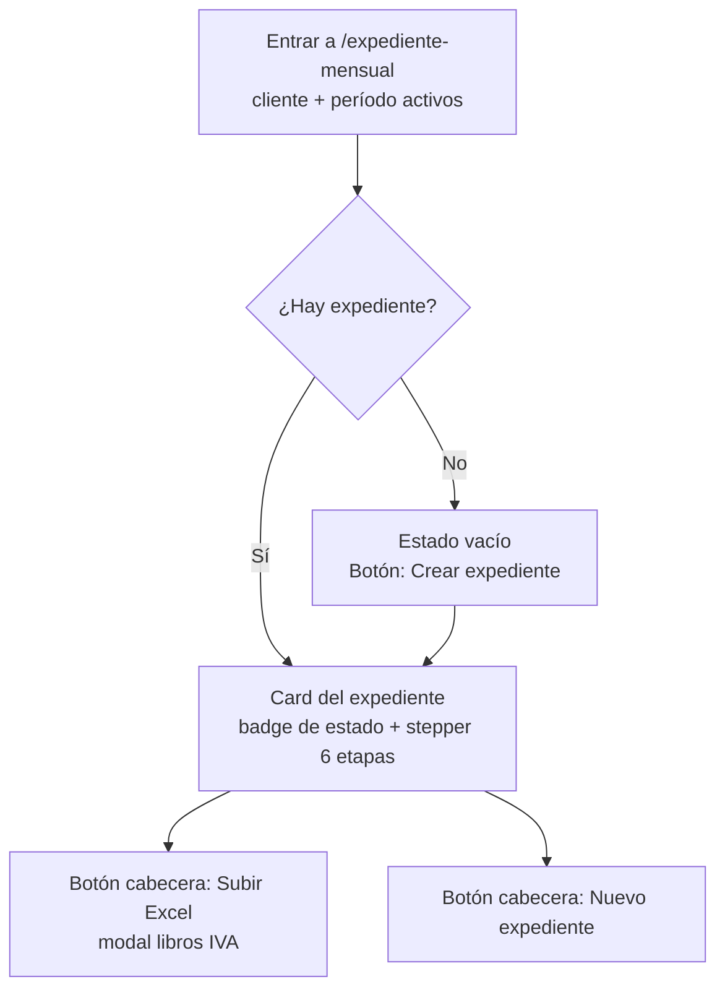
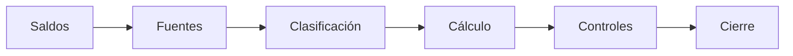
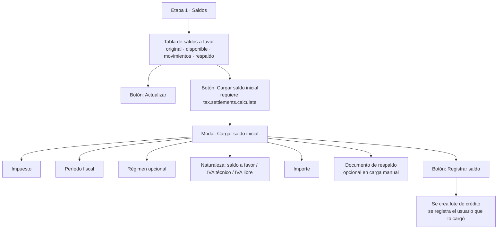
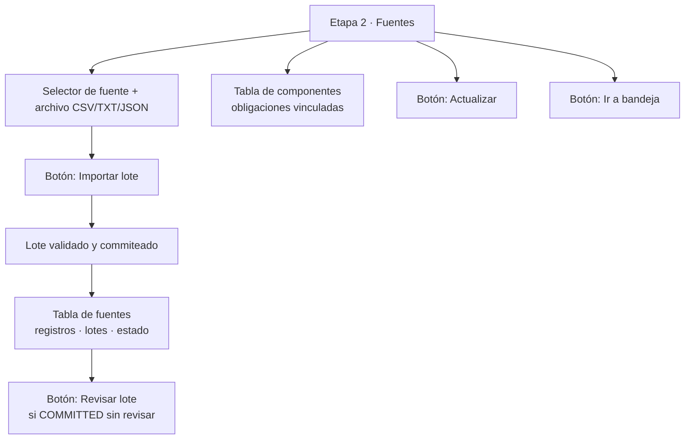
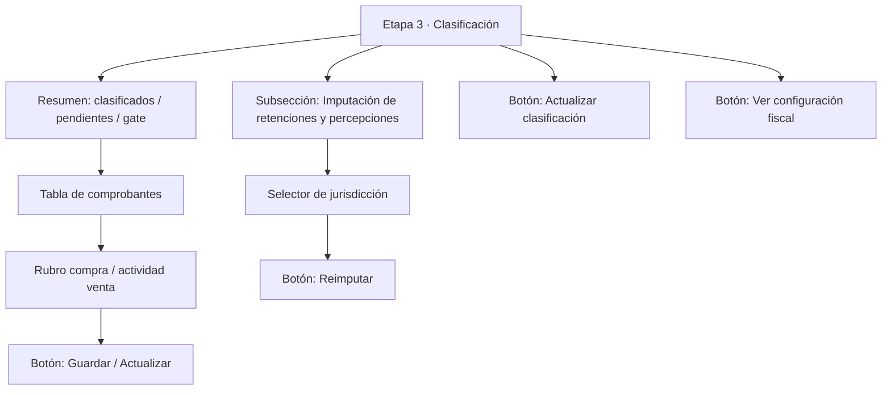
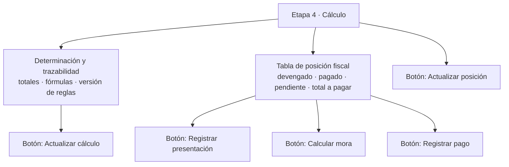
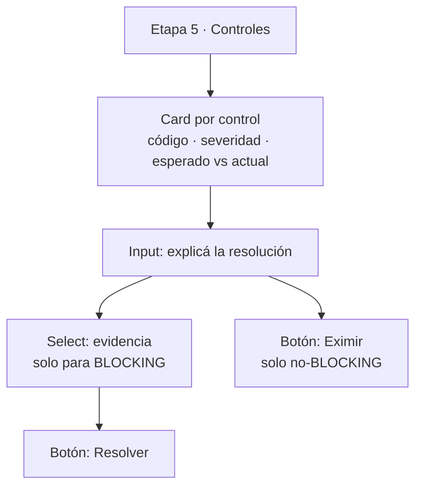
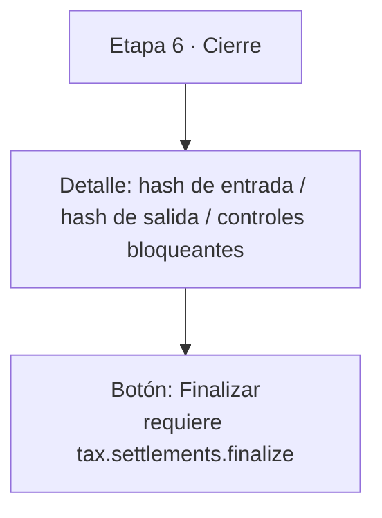
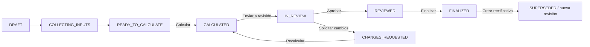
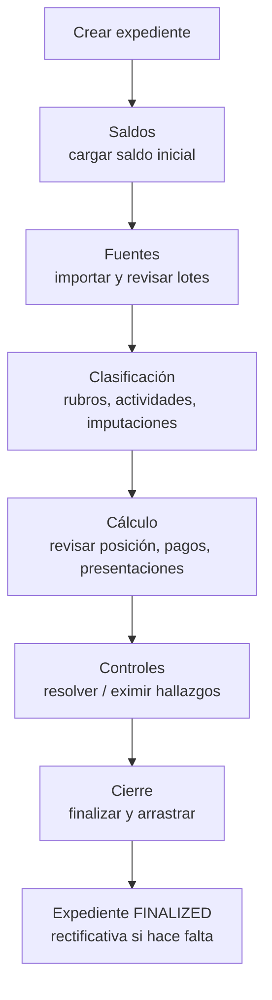

# Flujograma del Expediente Mensual — Acciones y botones por etapa

> **Propósito:** explicar, de forma visual y paso a paso, el flujo de trabajo de la interfaz web al entrar al **Expediente mensual** (`/expediente-mensual`). Describe las **6 etapas** del stepper persistente, las **acciones** disponibles en cada una y los **botones** que las disparan, para que preparador y revisor entiendan qué hacer y en qué orden.
>
> La vista usa un **stepper persistente** (no un wizard que oculta información): las 6 etapas están siempre visibles y se puede saltar entre ellas libremente. El estado del expediente (badge) y los controles bloqueantes determinan qué botones están habilitados.

---

## 0. Antes de empezar: crear el expediente

Al entrar a `/expediente-mensual` con un cliente y período activos, la pantalla muestra:

- **Botón "Subir Excel"** (cabecera): abre el modal para importar los libros IVA (ventas/compras) desde Excel. Disponible con capacidad `tax.vouchers.prepare`.
- **Botón "Nuevo expediente"** (cabecera): crea el expediente mensual del período. Disponible con `tax.settlements.calculate`.
- Si **no hay expedientes** para el período, se muestra un estado vacío con el botón **"Crear expediente"**.

> El expediente nace en estado `DRAFT`. A partir de ahí se recorre el stepper.

---

## 1. Las 6 etapas del stepper

El stepper persistente tiene 6 etapas. Cada una tiene un **menú de pestañas** (clic directo) y botones **Anterior / Siguiente** para moverse en orden.

| # | Etapa | Descripción |
|---|---|---|
| 1 | **Saldos** | Arrastres, créditos y saldos iniciales antes de calcular |
| 2 | **Fuentes** | Documentación y componentes requeridos para sostener el cálculo |
| 3 | **Clasificación** | Actividades, criterios y configuración que determinan alícuotas |
| 4 | **Cálculo** | Posición fiscal, pagos, presentaciones e intereses del período |
| 5 | **Controles** | Hallazgos, bloqueos y resoluciones antes de cerrar |
| 6 | **Cierre** | Hashes, finalización y arrastre al siguiente período |

> **Navegación común a todas las etapas:** menú de pestañas (1–6), botón **"Anterior: <etapa>"**, botón **"Siguiente: <etapa>"**, y en el pie **"Volver a <etapa>"** / **"Ir a <etapa>"**.

---

## 2. Etapa 1 — Saldos

**Objetivo:** registrar y revisar los saldos a favor y arrastres disponibles por impuesto, régimen y jurisdicción.

**Acciones y botones:**

| Acción | Botón | Condición / capacidad |
|---|---|---|
| Refrescar la tabla de saldos | **Actualizar** | Siempre |
| Abrir el formulario de carga | **Cargar saldo inicial** | `tax.settlements.calculate` |
| Confirmar la carga | **Registrar saldo** | Impuesto + período + importe completos |
| Cancelar la carga | **Cancelar** | — |

> **Carga manual:** el saldo inicial puede ingresarse manualmente **sin** adjuntar un comprobante. El sistema conserva el **usuario que lo registró** (`createdByUserId`) para trazabilidad.

---

## 3. Etapa 2 — Fuentes

**Objetivo:** declarar qué documentación y componentes llegaron y qué todavía bloquea el cálculo.

**Acciones y botones:**

| Acción | Botón | Condición / capacidad |
|---|---|---|
| Elegir fuente y archivo | Selector + input file | `tax.vouchers.prepare` y expediente editable |
| Importar el lote | **Importar lote** | Fuente + archivo seleccionados |
| Revisar un lote commiteado | **Revisar** | `tax.vouchers.review` |
| Refrescar cobertura | **Actualizar** | Siempre |
| Ir a la bandeja de trabajo | **Ir a bandeja** | — |

> El cálculo queda bloqueado mientras una fuente **obligatoria** no esté presente (`WAITING_INPUTS`).

---

## 4. Etapa 3 — Clasificación

**Objetivo:** completar actividades y rubros que determinan las alícuotas, e imputar retenciones/percepciones.

**Acciones y botones:**

| Acción | Botón | Condición / capacidad |
|---|---|---|
| Clasificar un comprobante | **Guardar** / **Actualizar** | `tax.vouchers.prepare` |
| Reimputar un certificado | **Reimputar** | `tax.vouchers.prepare` |
| Refrescar clasificación | **Actualizar clasificación** | Siempre |
| Ir a configuración fiscal | **Ver configuración fiscal** | — |

> El cálculo queda bloqueado mientras exista una compra sin rubro o una venta sin actividad (`WAITING_INPUTS`).

---

## 5. Etapa 4 — Cálculo

**Objetivo:** revisar la posición fiscal del período: devengado, pagos, presentaciones e intereses.

**Acciones y botones:**

| Acción | Botón | Condición / capacidad |
|---|---|---|
| Refrescar determinación | **Actualizar cálculo** | Siempre |
| Refrescar posición | **Actualizar posición** | Siempre |
| Registrar presentación | **Registrar presentación** | `tax.filings.record` y liquidación presente |
| Calcular intereses por mora | **Calcular mora** | Pendiente > 0, vencido, liquidación FINALIZED, `tax.payments.record` |
| Registrar pago | **Registrar pago** | Total a pagar > 0, `tax.payments.record` |

---

## 6. Etapa 5 — Controles

**Objetivo:** revisar hallazgos, bloqueos y resoluciones antes de cerrar.

**Acciones y botones:**

| Acción | Botón | Condición / capacidad |
|---|---|---|
| Resolver un control | **Resolver** | `tax.settlements.review`, resolución escrita (+ evidencia si BLOCKING) |
| Eximir un control | **Eximir** | `tax.settlements.review`, solo no-BLOCKING |

> Un control **BLOCKING** abierto impide finalizar el expediente (se muestra el contador "N control(es) bloqueante(s)" en la cabecera de la card).

---

## 7. Etapa 6 — Cierre

**Objetivo:** revisar hashes y finalizar el expediente para arrastrar saldos al siguiente período.

**Acciones y botones:**

| Acción | Botón | Condición / capacidad |
|---|---|---|
| Finalizar el expediente | **Finalizar** | `tax.settlements.finalize`, sin controles BLOCKING abiertos |

---

## 8. Acciones globales del expediente (pie de la card)

Independientemente de la etapa activa, el pie de la card muestra el botón correspondiente al **estado** del expediente:

| Estado del expediente | Botón | Capacidad |
|---|---|---|
| `DRAFT` / `COLLECTING_INPUTS` / `READY_TO_CALCULATE` | **Calcular** | `tax.settlements.calculate` (solo si `READY_TO_CALCULATE`) |
| `CHANGES_REQUESTED` | **Recalcular** | `tax.settlements.calculate` |
| `CALCULATED` | **Enviar a revisión** | `tax.settlements.submit_review` |
| `IN_REVIEW` | **Aprobar revisión** / **Solicitar cambios** | `tax.settlements.review` |
| `REVIEWED` | **Finalizar** | `tax.settlements.finalize` |
| `FINALIZED` | **Crear rectificativa** | `tax.settlements.rectify` |

---

## 9. Resumen del flujo completo

> **Consejo de uso:** el orden natural es 1 → 6, pero el stepper permite saltar. El sistema **bloquea el cálculo** (botón "Calcular" deshabilitado) hasta que las fuentes obligatorias estén presentes y las clasificaciones estén completas, y **bloquea la finalización** mientras existan controles BLOCKING abiertos.
