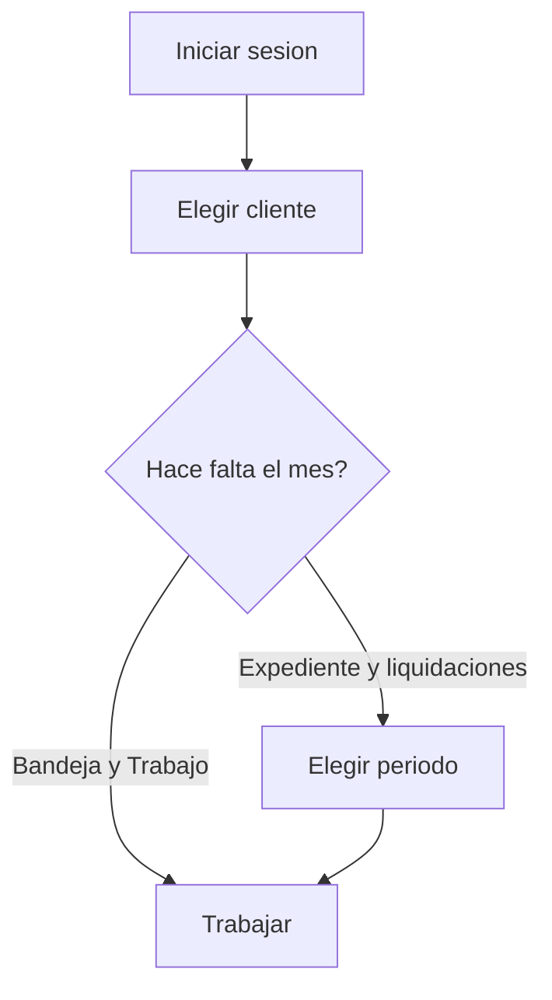
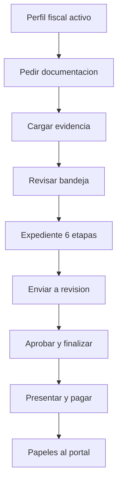
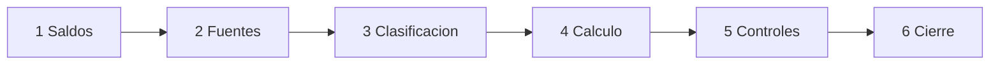

# Manual de procedimientos internos — Estudio

Paso a paso para el equipo del estudio que trabaja en **Contable**.
No cubre el portal del cliente (ese manual va aparte) ni la operación técnica del servidor.

| | |
|---|---|
| **Para quién** | Titular, administrador, preparador, revisor y auditor de sólo lectura |
| **Para qué** | Liquidar un período con evidencia, revisión y publicación controlada |
| **Regla de oro** | La plataforma propone y ordena. El estudio revisa, corrige y aprueba. Nada llega al cliente sin esa aprobación |

---

## 1. Qué hace y qué no hace esta herramienta

Contable es la mesa de trabajo del estudio: reúne documentos, arma el expediente del mes, calcula impuestos, deja rastro de quién tocó cada cifra y publica al cliente **solo** lo aprobado.

No reemplaza el criterio profesional. No presenta por sí sola ante ARCA ni organismos provinciales. No es un sistema de contabilidad legal completo: **Contabilidad**, **Reportes y análisis** y **Asistente contable** todavía no están liberados en la navegación.

---

## 2. Principios que no se negocian

1. **Siempre hay un contexto.** Antes de operar, elegí **cliente** y, cuando corresponda, **período** en la barra superior.
2. **Cuatro ojos.** Quien prepara no puede revisar el mismo expediente o liquidación. Titular y administrador pueden hacer las dos cosas, pero no sobre el mismo objeto.
3. **La evidencia manda.** No se calcula ni se cierra con fuentes incompletas, duplicadas o sin revisar.
4. **Cerrado es cerrado.** Un período o liquidación finalizados no se editan: se abre una **rectificativa** (nueva versión). La anterior queda como historial.
5. **El portal es un vidrio, no un taller.** El cliente carga lo que se le pide y ve lo publicado. No ve borradores, reglas internas ni controles abiertos.

---

## 3. Cómo entrar

1. Abrí Contable e ingresá con **correo** y **contraseña**.
2. Si el estudio tiene doble factor, cargá el **código de verificación**.
3. Quedás en **Inicio**. En el menú izquierdo están las secciones de tu rol.
4. La primera vez (o cuando quieras) podés usar **Recorrer el estudio** (abajo a la izquierda) para ubicar cada bloque.

Si no ves un cliente: no está asignado a tu usuario. Pedile al titular o al administrador que te lo asigne en **Usuarios y accesos**.

---

## 4. Barra de contexto (lo primero de cada sesión)

Arriba ves **Estudio**, **Cliente** y **Período**.

| Campo | Qué hace |
|---|---|
| Estudio | Queda fijo para el equipo del estudio |
| Cliente | Define de qué empresa estás hablando. Sin esto no se abre bandeja, expediente ni liquidaciones |
| Período | Define el mes de trabajo. Lo piden Expediente, Liquidaciones y Rentabilidad |

El badge al lado del período muestra si está abierto, en trabajo o cerrado. **No mezcles clientes ni meses:** si cambiás el selector, cambia toda la pantalla.

---

## 5. Mapa de pantallas del estudio

Lo que ves depende de tu rol. Lo que **no** aparece en el menú no está liberado para operar.

| Grupo | Pantalla | Para qué |
|---|---|---|
| General | **Inicio** | Pendientes, cartera y qué requiere atención |
| General | **Clientes** | Alta y ficha básica de la cartera |
| General | **Resumen del cliente** | Foto del cliente: perfil fiscal, períodos, obligaciones |
| Preparación | **Bandeja documental** | Recibir, extraer y revisar archivos |
| Preparación | **Configuración fiscal** | Perfil, regímenes, actividades, períodos y obligaciones |
| Ejecución | **Trabajo** | Pedidos al cliente, mensajes y vencimientos |
| Ejecución | **Expediente mensual** | Circuito del mes (el corazón del trabajo) |
| Ejecución | **Liquidaciones** | Cartera por impuesto, cierre, papeles PDF/CSV, rectificativa |
| Análisis | **Rentabilidad** | Resultado de gestión (devengado y caja), aparte de lo fiscal |
| Configuración | **Usuarios y accesos** | Equipo interno e invitaciones al portal |
| Configuración | **Reglas fiscales** | Alícuotas, vencimientos y fuentes normativas del estudio |

---

## 6. Quién hace qué

| Rol en pantalla | Encargado de | No hace |
|---|---|---|
| **Titular** / **Administrador** | Toda la cartera, usuarios, reglas, y puede preparar o revisar | No puede ser preparador y revisor del mismo expediente |
| **Preparador** | Pedir docs, cargar, clasificar, calcular, enviar a revisión | Aprobar, finalizar, registrar presentación/pago, publicar rentabilidad |
| **Revisor** | Controlar fuentes, aprobar o pedir cambios, finalizar, presentar, pagar, publicar | Preparar el mismo objeto que va a revisar |
| **Auditor · sólo lectura** | Consultar | Cambiar datos |

Preparador, revisor y auditor **sólo ven los clientes asignados**. Titular y administrador ven toda la firma.

---

## 7. Circuito del mes (visión de conjunto)

Este es el orden de trabajo habitual. No saltees revisión.

| Paso | Dónde | Listo cuando |
|---|---|---|
| 1. Cliente en condiciones | Clientes + Configuración fiscal | Perfil **activo**, regímenes, actividades, período y obligaciones |
| 2. Pedir lo que falta | Trabajo | Pedido enviado, con fecha límite e ítems claros |
| 3. Entrar la evidencia | Bandeja documental | Cada archivo validado, extraído y **aprobado** contra el original |
| 4. Armar el mes | Expediente mensual | Fuentes cubiertas, clasificación hecha, controles resueltos |
| 5. Calcular | Expediente / Liquidaciones | Posición calculada, sin diferencias abiertas |
| 6. Cuatro ojos | Expediente | Revisor distinto del preparador **aprueba** |
| 7. Cerrar | Expediente | **Finalizar** (el mes queda congelado) |
| 8. Organismo y cobro | Expediente · etapa Cálculo | Presentación con acuse y pago registrados |
| 9. Informar al cliente | Liquidaciones | PDF y CSV generados; el portal muestra sólo eso |
| 10. Gestión (opcional) | Rentabilidad | Devengado y caja calculados; **publicar** si el cliente debe verlos |

---

## 8. Alta de un cliente

**Pantalla:** Clientes. Hace falta permiso de gestión de clientes (titular o administrador).

1. **Crear cliente**.
2. Completá razón social, nombre comercial, CUIT, condición frente al IVA, forma jurídica, provincia, moneda (por ejemplo `ARS`) y datos de alta en el estudio.
3. Guardá. La configuración impositiva fina **no** se termina acá: sigue en **Configuración fiscal**.
4. Asigná quién del equipo trabaja esa cuenta (**Usuarios y accesos**).
5. Si el cliente va a cargar solo, invitá al portal (ver § 14).

**Resumen del cliente** sirve para controlar que el alta quedó completa: perfil, inscripciones, períodos y obligaciones. Si algo falta, el recuadro **Próximo paso** te dice a qué pantalla ir.

---

## 9. Configuración fiscal (antes del primer mes)

**Pantalla:** Configuración fiscal. Elegí el cliente.

Orden sugerido:

1. **Crear perfil** con CUIT, razón social y condición nacional. Queda en borrador.
2. **Enviar a revisión** y **Activar perfil**. Sin perfil activo no hay liquidación seria.
3. **Registrar inscripción** de cada régimen que aplique (IVA, IIBB por jurisdicción, TEM, monotributo, CM03, etc.).
4. **Vincular actividad económica** (la que define alícuotas y bases).
5. **Crear período** fiscal (mes de trabajo, fechas reales).
6. **Crear obligación** vinculando régimen + período + vencimiento.

Si hay que corregir el perfil vigente: **Crear nueva versión**. No se pisa el historial.

Las **reglas fiscales** (alícuotas, vencimientos, fuentes) viven a nivel estudio, no del cliente. Las propone y aprueba titular/administrador en **Reglas fiscales**. Un cálculo usa la versión vigente en esa fecha; un mes ya cerrado conserva la versión con la que se liquidó.

---

## 10. Pedir documentación al cliente

**Pantalla:** Trabajo.

1. Elegí cliente (y período si el pedido es del mes).
2. **Pedir documentación** / **Crear pedido**.
3. Poné asunto, instrucciones claras, fecha límite e ítems (qué archivo esperás: libro IVA, retenciones, extracto, acuse, etc.).
4. Enviá el pedido. El cliente lo ve en el portal, en pendientes.

Cuando llegan archivos:

- **Verificar pedidos**: aceptar, rechazar (con motivo) o dispensar un ítem.
- **Enviar mensaje** si hace falta una precisión. El rol de sólo lectura del portal no puede responder.

No subas “cualquier PDF suelto” si podés atarlo a un ítem del pedido: eso conserva la trazabilidad.

---

## 11. Bandeja documental

**Pantalla:** Bandeja documental. Siempre con un cliente elegido.

### Si carga el estudio

1. **Subir documento**.
2. Elegí el **ítem solicitado** al que corresponde (si hay pedido abierto).
3. **Elegir archivo** y **Subir y procesar**.
4. El archivo pasa por validación y lectura asistida. Esperá a que deje de decir **Procesando comprobante**.

Formatos habituales: PDF o imagen. No uses la bandeja como disco compartido.

### Si carga el cliente

El archivo aparece en la bandeja del estudio. El preparador abre el documento, confronta **Datos detectados** con el original (**Ver o descargar el archivo**) y aprueba o corrige.

### Revisión de la extracción

1. Abrí el documento.
2. Controlá CUIT, fechas, importes, tipo de comprobante y que sea de **ese** cliente y **ese** mes.
3. Corregí lo que la lectura haya propuesto mal.
4. Aprobá cuando el dato coincida con el papel. Recién ahí es evidencia usable en el expediente.

Si no hay pedido: andá a **Trabajo** y crealo. La bandeja te va a pedir ese vínculo.

---

## 12. Expediente mensual (el circuito de las 6 etapas)

**Pantalla:** Expediente mensual. Requiere cliente **y** período.

### Crear el expediente

- Cabecera: **Nuevo expediente**, o **Crear expediente** si la pantalla está vacía.
- Nace en borrador.
- **Subir Excel** (libros IVA compras y ventas por separado) cuando la fuente sea el libro, no un PDF suelto.

Las seis etapas quedan **siempre visibles**. Podés saltar, pero el cálculo no habilita si falta evidencia.

### Etapa 1 — Saldos

Arrastres y saldos a favor del mes anterior.

- Revisá original, disponible, movimientos y respaldo.
- **Cargar saldo inicial** si el mes arranca con un saldo que todavía no está en el sistema (impuesto, período, naturaleza, importe, documento de respaldo si lo hay).
- **Editar saldo** si hay que corregir referencia o respaldo. Queda auditado.

### Etapa 2 — Fuentes

Cobertura de lo que el cálculo necesita (libros, retenciones, sueldos, etc.).

- Subí o vinculá cada fuente.
- El revisor **aprueba el lote** de importación. El preparador no se autoaprueba.
- Si falta un archivo, volvé a **Bandeja** o **Trabajo**.

### Etapa 3 — Clasificación

Actividades, rubro del proveedor y criterios que cambian alícuotas (por ejemplo comercio vs. transporte).

- Completá lo pendiente. El expediente tiene que llegar a **clasificados / 0 pendientes**.
- Si falta una actividad en el perfil, andá a **Configuración fiscal**; no la “inventes” en el cálculo.

### Etapa 4 — Cálculo

Acá se ve la posición del mes (IVA, IIBB, TEM u otros regímenes activos).

El botón **Calcular** se habilita cuando el expediente está **listo para calcular** (fuentes revisadas y clasificación completa). Si el revisor pidió cambios, el botón pasa a **Recalcular**.

También desde esta etapa se registran, cuando corresponda:

- **Registrar presentación** (fecha, importe, identificador, acuse).
- **Registrar pago**.
- Intereses si hay mora.

La presentación formal con acuse exige liquidación **finalizada** y evidencia lista. No des por presentada una DDJJ que el organismo no recibió.

### Etapa 5 — Controles

Hallazgos que pueden **bloquear** el cierre. Ejemplos que muestra la pantalla:

- Diferencias de libro por alícuota
- Conciliación con Portal IVA
- Acreditaciones bancarias vs. facturación
- Caja e imputaciones del período

Cada control bloqueante se resuelve con evidencia (un documento de la bandeja, una explicación registrada). **No finalices con controles abiertos.**

### Etapa 6 — Cierre

Según el estado del expediente:

| Estado | Quién | Botón |
|---|---|---|
| Listo para calcular | Preparador | **Calcular** |
| Calculado | Preparador | **Enviar a revisión** |
| En revisión | Revisor | **Aprobar revisión** o **Solicitar cambios** |
| Revisado | Revisor | **Finalizar** |
| Finalizado | Revisor | **Crear rectificativa** si hay que enmendar |

**Finalizar** congela hashes de entrada y salida y genera los saldos de cierre para el mes siguiente. A partir de ahí no se “arregla el mismo”: se rectifica.

---

## 13. Liquidaciones (cartera por impuesto)

**Pantalla:** Liquidaciones. Cliente + período.

Sirve para ver el tablero del mes: cada régimen, versión (`v1`, `v2`…), estado y total a ingresar.

Acciones según estado (las ves sólo si tu rol las permite):

| Botón | Cuándo |
|---|---|
| **Ver expediente** / **Abrir expediente** | Siempre, para volver a la evidencia |
| **Calcular liquidación** | Hay régimen y período, y la documentación aprobada alcanza |
| **Enviar a revisión** | Estado calculado |
| **Revisar** | Estado en revisión |
| **Finalizar** | Estado revisado |
| **Rectificar** | Ya finalizado: abre `v2` en borrador y conserva `v1` |
| **PDF** / **CSV** | Finalizado: papel de trabajo que el portal puede mostrar |

El cálculo **sólo toma documentación aprobada**. Si el número no cierra, el problema casi nunca está en el botón: está en fuentes, clasificación o saldos.

---

## 14. Qué ve el cliente (y qué no)

El estudio invita al portal desde **Usuarios y accesos**, con un cliente seleccionado:

1. **Invitar al portal** (email + rol).
2. Roles del cliente: **Titular** (carga y consulta), **Colaborador** (carga), **Sólo lectura** (consulta).
3. Copiá el enlace. La invitación vence a los **siete días** y vale para ese correo.
4. **Revocar acceso** o **revocar invitación** cuando la persona deje de operar.

En el portal el cliente puede:

- ver pendientes y cargar archivos (si su rol lo permite);
- consultar obligaciones, liquidaciones **publicadas**, reportes publicados y rentabilidad **publicada**;
- escribir mensajes atados a un pedido.

No puede ver borradores, controles internos, reglas ni corregir una liquidación. Si algo “no le aparece”, casi siempre es porque el estudio **todavía no finalizó o no generó el PDF/CSV**, o porque su rol es de sólo lectura.

---

## 15. Rentabilidad (aparte de lo fiscal)

**Pantalla:** Rentabilidad. No contamina IVA/IIBB/TEM.

1. Elegí cliente y período con obligaciones materializadas.
2. **Calcular devengado**.
3. **Calcular caja**.
4. El revisor **publica** si el cliente debe verlo. Hasta entonces, no sale en el portal.

Tratá estos números como **gestión**, no como estados contables certificados.

---

## 16. Usuarios internos

**Pantalla:** Usuarios y accesos (titular o administrador).

1. **Invitar al estudio** con email y rol interno.
2. El rol define los módulos que esa persona ve.
3. Para preparador/revisor/auditor: asigná clientes. Sin asignación, la persona entra pero no opera cuentas.

**Módulos de estudios** es una pantalla de administración de la plataforma, no del día a día del estudio.

---

## 17. Si esto pasa

| Situación | Qué hacer |
|---|---|
| No veo el cliente | Pedir asignación. No es un error de la pantalla |
| No puedo calcular | Faltan fuentes revisadas o clasificación. El botón lo dice |
| No puedo aprobar un expediente que armé yo | Es correcto: tiene que revisar otra persona |
| El cliente no ve la liquidación | ¿Está **finalizada**? ¿Se generaron **PDF/CSV**? ¿El acceso al portal sigue activo? |
| Hay que corregir un mes cerrado | **Rectificar** / **Crear rectificativa**. No reabrir a mano |
| La lectura del PDF está mal | Corregir en bandeja **antes** de aprobar. No arrastres un dato dudoso al expediente |
| Pedido eterno en Trabajo | Verificar ítems: aceptar, rechazar con motivo o dispensar |
| Perfil fiscal en borrador | Enviar a revisión y activar. Sin eso el mes no arranca bien |
| Controles en rojo | Resolverlos con evidencia en etapa 5. Bloquean el cierre |
| Olvidé el contexto y cargué en otro cliente | Parar. Cambiar el selector no mueve el archivo. Revisar bandeja del cliente correcto y no aprobar lo ajeno |

---

## 18. Rutina sugerida del mes

**Primera semana**

- Confirmar perfil, período y obligaciones.
- Armar el pedido documental y mandarlo.
- Cargar saldos iniciales si el mes lo requiere.

**Durante el mes**

- Vaciar bandeja todos los días: extraer, corregir, aprobar.
- Completar fuentes y clasificación del expediente.

**Semana de vencimiento**

- Calcular.
- Revisor distinto: controles, aprobación, cierre.
- Presentar con acuse, registrar pago.
- Generar papeles y, si corresponde, publicar rentabilidad.
- Avisar al cliente que ya puede consultar el portal.

---

## 19. Fuera de este manual

- Cómo usa el **cliente** el portal → manual de usuario del cliente (siguiente entrega).
- Cómo se instala o se respalda el servidor → documentación técnica en `docs/dev/`.
- Detalle de cada botón del expediente → `docs/flujograma-expediente-mensual.md`.
- Lógica de cálculo heredada del Excel de liquidación → `docs/proceso-liquidacion-mensual.md`.
