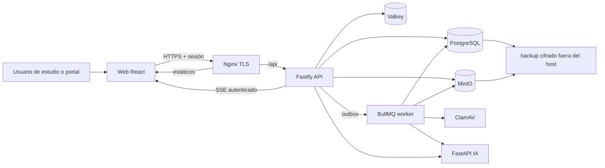

# Plan técnico de preparación para producción general

**Producto:** Contable  
**Fecha de auditoría:** 2026-08-19  
**Estado:** propuesta técnica para implementación  
**Objetivo de salida:** producción general, autoalojada, con todo el producto disponible.  

---

## 1. Decisiones de alcance

Este documento convierte la auditoría técnica y funcional en un plan ejecutable. Las siguientes decisiones se consideran fijadas para evitar ambigüedad durante la implementación:

- El producto debe quedar disponible para uso general, no sólo para un piloto controlado.
- El alcance incluye estudio contable, portal de cliente, documentos, contabilidad, liquidaciones fiscales, rentabilidad, reportes, BI y asistente.
- La operación inicial será autoalojada. No se establece un SLA contractual en esta etapa, pero sí se exige seguridad operativa, backup cifrado y restauración comprobada.
- Las notificaciones serán exclusivamente in-app. No habrá email, WhatsApp ni webhook de entrega para el lanzamiento.
- La IA continuará siendo una herramienta de consulta, extracción y planificación; nunca podrá contabilizar, liquidar, publicar ni presentar impuestos por sí misma.
- Las credenciales fiscales y la presentación automática ante organismos no forman parte de este alcance.

Una feature flag puede seguir existiendo para realizar un despliegue gradual por estudio o régimen, pero no podrá utilizarse para ocultar una funcionalidad incompleta declarada como disponible en producción.

---

## 2. Diagnóstico de partida

### 2.1 Estado de calidad del frontend

| Dimensión | Puntaje | Evidencia principal |
|---|---:|---|
| Accesibilidad | 3/4 | Contraste base AA, foco visible, skip links, labels y estados `aria-live` en varios flujos. |
| Rendimiento | 3/4 | Rutas cargadas de forma diferida y bundle inicial de aproximadamente 93 KB gzip. |
| Diseño adaptable | 2/4 | La pantalla pública de acceso funciona a 360 px, pero no hay verificación automatizada de pantallas autenticadas densas. |
| Theming | 2/4 | Hay tokens sólidos, pero varias pantallas usan variables CSS no definidas y colores directos. |
| Antipatrones visuales | 3/4 | La interfaz respeta el estilo cálido y utilitario definido; quedan inconsistencias puntuales, no un problema de identidad. |
| **Total** | **13/20** | Aceptable como base, insuficiente para liberar a producción general. |

Aspectos que se deben conservar: tipografía local, paleta marfil/verde, tablas densas, jerarquía izquierda, color reservado para estado y riesgo, y la IA fuera del protagonismo visual.

### 2.2 Bloqueos de liberación actuales

| Severidad | Hallazgo | Ubicación principal | Consecuencia |
|---|---|---|---|
| P0 | El dashboard pide el worklist fiscal sin un contexto de firma válido. | `apps/web/src/study/StudyDashboard.tsx`, `apps/api/src/auth/guard.ts` | La cartera fiscal responde 401 y se muestra un vacío falso. |
| P0 | El rol runtime no tiene permisos efectivos sobre invitaciones y membresías del portal en una base ya migrada. | Migraciones Prisma / `apps/api/src/portal/routes.ts` | Administración devuelve 500 y no se pueden gestionar accesos del portal. |
| P0 | La suite raíz no está en verde. | `npm test` | Dos pruebas API fallan al no existir MinIO local y una prueba web tiene una expectativa de capabilities obsoleta. |
| P0 | Contabilidad, reportes y asistente existen como componentes pero no son rutas de la aplicación. | `apps/web/src/App.tsx` | Parte de la propuesta de valor es inaccesible para usuarios reales. |
| P0 | El Compose actual permite arrancar producción con secretos por defecto y expone servicios internos por puertos host. | `infra/compose/docker-compose.yml`, `.env.example` | Riesgo de acceso no autorizado y configuración insegura. |
| P0 | La configuración actual de notificaciones depende de un webhook; sin él, los jobs fallan de forma sostenida. | `apps/worker/src/notification-processor.ts` | Contradice la decisión de notificaciones sólo dentro de la aplicación. |
| P1 | `/health/ready` está degradado en el entorno revisado: Valkey y MinIO no están disponibles. | `apps/api/src/server.ts` | La instancia no está operativamente lista aunque el proceso esté vivo. |
| P1 | La autenticación HMAC de Node/worker hacia IA no registra nonces consumidos. | `services/ai/app/auth.py` | Un request firmado puede reproducirse dentro de la ventana temporal. |
| P1 | Llamadas a IA desde Node no tienen timeout y el asistente mantiene una transacción de BD durante una llamada remota. | `apps/api/src/assistant/assistant-service.ts`, `apps/api/src/bi/bi-service.ts`, `apps/worker/src/ai-client.ts` | Riesgo de agotamiento de conexiones, bloqueos y solicitudes colgadas. |
| P1 | Hay topics de worker expuestos que fallan explícitamente como `UNSUPPORTED_*`. | `apps/worker/src/index.ts` | Outbox y operaciones de fondo no están completos para todo el producto. |
| P1 | No hay E2E de navegador en CI ni cobertura directa de la mayoría de pantallas. | `.github/workflows/ci.yml`, `apps/web/src` | Regresiones de permisos, navegación y UX pueden llegar a producción. |
| P1 | No existe telemetría operativa completa ni una práctica implementada de backup/restore. | API, worker, IA e infraestructura | No hay capacidad suficiente para detectar, contener o recuperar incidentes. |
| P1 | `npm audit --omit=dev` reporta vulnerabilidades altas en la cadena Prisma/deepmerge-ts. | `package-lock.json` | Riesgo de cadena de suministro y bloqueo de gate de seguridad. |
| P2 | El onboarding fiscal no presenta errores de sus múltiples consultas y mutaciones. | `apps/web/src/study/StudyOnboardingFiscal.tsx` | El usuario puede interpretar una falla como ausencia de datos. |
| P2 | Hay referencias a tokens inexistentes y colores hard-coded en rentabilidad y riesgo. | `apps/web/src/study/study.css`, `apps/web/src/portal/portal.css` | Inconsistencia visual y propiedades CSS que se descartan silenciosamente. |
| P2 | Nginx declara `/events`, pero la API no implementa ese endpoint. | `infra/nginx/nginx.conf` | No hay actualización de estados de procesos de fondo. |

### 2.3 Gaps del núcleo operativo: liquidación mensual

El documento de proceso mensual incorpora una condición adicional para liberar el producto: no alcanza con que cada régimen pueda calcularse de manera aislada. El estudio necesita preparar, controlar, revisar y cerrar un **expediente mensual único** que coordine IVA, IIBB y TEM, conserve su evidencia y proyecte los saldos del período siguiente. La implementación actual cubre partes de ese flujo, pero presenta los siguientes desvíos verificables.

| Severidad | Gap verificado | Evidencia técnica | Consecuencia de negocio | Tratamiento exigido |
|---|---|---|---|---|
| P0 | La importación de libros no determina correctamente si un comprobante es venta o compra. | `apps/api/src/tax/ingestion-service.ts`: `taxTypeId` siempre es truthy, por lo que `direction` queda en `PURCHASE`; además `isSale` es un placeholder fijo en `false`. | El débito fiscal, las ventas por actividad y los regímenes derivados pueden calcularse sobre datos invertidos o incompletos. | La dirección debe venir del adaptador/origen tipado, validarse contra el archivo y quedar en el hash del lote; eliminar inferencias y placeholders. |
| P0 | El commit de un lote afirma ser atómico pero atrapa errores por fila, marca el lote `COMMITTED` y conserva escrituras parciales. | `IngestionService.commitBatch()`. | Se puede liquidar con un libro incompleto sin que el estado del lote lo impida. | Prevalidación completa, transacción única, estados `FAILED`/`VALIDATED` coherentes y bloqueo de cálculo mientras exista una fila inválida o no confirmada. |
| P0 | Certificados, créditos y ajustes se consumen globalmente por cliente, sin filtrar ni asignar por período, impuesto, régimen, jurisdicción o estado aprobado. | `SettlementService.calculate()` agrega certificados y `tax_credit_ledger_entries` sin esos filtros; los certificados actuales no modelan toda la dimensión fiscal necesaria. | Una liquidación puede descontar retenciones, percepciones o saldos de otro impuesto, jurisdicción o mes. | Modelar alcance y asignación explícitos; sólo inputs aprobados, vigentes y reservados para la obligación pueden entrar al cálculo. |
| P0 | El motor IVA actual usa bases genéricas (`VENTAS`/`COMPRAS`) y tasas de reglas, pero no reproduce el detalle por alícuota, NC, Dto. 814, restituciones ni compensaciones del proceso fuente. | `packages/tax-engine/src/vat.ts` y construcción de `facts` en `SettlementService`. | El resultado puede diferir del libro y de la DDJJ aun cuando los importes originales sean correctos. | Implementar motor IVA RI versionado sobre componentes reales, con renglones y controles equivalentes al papel de trabajo. |
| P0 | IIBB y TEM no reciben créditos y saldos con atribución completa por jurisdicción/tributo; CM03 los concentra en una jurisdicción primaria. | `SettlementService.calculate()` y `packages/tax-engine/src/cm03.ts`. | Se imputan créditos a una provincia equivocada o se ocultan saldos a favor. | Asignación por jurisdicción, origen y período; prohibir el fallback a una jurisdicción primaria. |
| P0 | No existe un agregado de cierre que relacione las liquidaciones de IVA, IIBB y TEM del mismo mes. | Modelo actual: `TaxSettlement` individual por régimen/período. | No hay una decisión de cierre mensual, total a pagar consolidado, controles transversales ni arrastre coordinado. | Crear un expediente mensual fiscal que gobierne los componentes, controles, evidencia, versión y cierre. |
| P1 | No existe modelo ni importador de F.931, maestro de proveedores/rubros ni conciliación Portal IVA como entradas auditables del cálculo. | No hay entidades ni servicios dedicados; el Excel los usa como fuentes directas. | Falta crédito Dto. 814, clasificación para actividades y evidencia de conciliación. | Incorporar subledgers y catálogos versionados, con revisión humana y vínculo a documento/lote. |
| P1 | Los controles requeridos por el proceso (diferencias de libro, Portal IVA, acreditaciones bancarias e intereses) no tienen contrato, evidencia ni bloqueo homogéneo. | Sólo existe `TaxDifference` genérico; no hay cálculo de intereses ni integración de controles de banco. | El revisor no puede demostrar por qué una diferencia se aceptó ni impedir un cierre riesgoso de manera consistente. | Introducir controles tipados, tolerancias de reglas, evidencia, resolución/revisión y bloqueo de finalización. |
| P1 | La rectificativa se crea sin copiar sus líneas y el cálculo posterior puede perder el delta contra la versión anterior. | `rectifyWithDelta()` consulta líneas de una liquidación nueva aún vacía. | La comparación de rectificativas no es confiable y puede no evidenciar cambios relevantes. | Capturar baseline de la versión sustituida, recalcular la nueva versión y generar delta sólo después de sus snapshots. |
| P1 | El arrastre de saldos y las compensaciones no tienen una semántica de libro inmutable ni protección de concurrencia. | `TaxCreditLedgerEntry.balanceAfter` mutable; `allocateCredit()` verifica y actualiza sin reserva transaccional explícita. | Doble aplicación de saldo a favor, saldo de apertura incorrecto o carrera entre dos preparadores. | Usar lotes y movimientos inmutables, reserva/consumo serializable y proyección versionada del próximo período. |
| P2 | La interfaz de liquidaciones es una tabla de estados y acciones; no expone cobertura, origen, controles, fórmulas, evidencia ni cierre mensual. | `apps/web/src/study/StudyLiquidaciones.tsx`. | El proceso sigue dependiendo de una planilla externa para revisar y explicar la posición fiscal. | Construir un expediente navegable con pasos, desvíos, trazabilidad hasta el comprobante y cierre explícito. |

---

## 3. Arquitectura objetivo

La arquitectura base se mantiene: React/Vite, Fastify/Prisma, worker BullMQ, FastAPI, PostgreSQL, Valkey, MinIO, ClamAV y Nginx. El trabajo consiste en cerrar sus fronteras y volverlas operables, no en sustituirlas.



Principios obligatorios:

1. Toda operación de negocio debe tener firma, cliente y período explícitos cuando corresponda; nunca se elegirá una membresía por orden de base de datos.
2. La API es la única autoridad de escritura de negocio. Los workers escriben sólo dentro de las capacidades y transacciones de sistema previstas.
3. La base mantiene RLS forzado como segunda barrera, verificado con credenciales runtime y worker reales.
4. Todo efecto asíncrono nace de outbox durable y deja estado observable, reintentable y auditable.
5. Una actualización de aplicación debe ser reversible; una migración de datos debe seguir el patrón expandir → migrar → contraer.

---

## 4. Frontend

### 4.1 Rutas, navegación y contexto

#### Problema

`StudyContabilidad`, `StudyReportes` y `StudyAsistente` no se importan con `lazy()` ni se registran en `App.tsx`. Además, `StudyShell` construye rutas literales con `:clientId`, por lo que Rentabilidad y Configuración fiscal pueden llevar a una URL inválida.

#### Implementación

1. Registrar rutas protegidas para los módulos existentes:

   - `/clientes/:clientId/contabilidad`
   - `/clientes/:clientId/reportes`
   - `/clientes/:clientId/asistente`
   - Mantener `/clientes/:clientId/rentabilidad` y `/clientes/:clientId/configuracion-fiscal`.

2. Convertir la configuración de navegación en una función dependiente de `clientId` y `capabilities`, no en una constante con placeholders.

3. Cuando una sección requiere cliente y no hay cliente activo:

   - Deshabilitar visualmente el acceso en la navegación con una explicación breve.
   - Navegar a `/clientes` al activar el acceso, en lugar de construir una URL incompleta.
   - Mantener el estado activo de la navegación sólo para rutas que existen.

4. Centralizar los labels de roles en un único módulo. Debe incluir los roles realmente definidos en contratos: `OWNER`, `ADMIN`, `PREPARER`, `REVIEWER` y `AUDITOR_READONLY`.

5. Añadir una frontera de error React para cada shell y una frontera por ruta diferida. El fallback debe permitir reintentar la carga, conservar el contexto y registrar el error con su identificador de correlación.

### 4.2 Cliente HTTP y estados de interfaz

Crear una capa de datos sobre React Query con estas responsabilidades:

- `request()` deberá aceptar un `AbortSignal` y usar un timeout de cliente. Nunca debe quedar una petición visible de manera indefinida.
- Normalizar errores de red, 401, 403, 409, 422 y 5xx en un tipo de error con `code`, `status`, `message`, `traceId` y opción de reintento.
- Al recibir 401, cerrar sesión de forma controlada y conservar la ruta de retorno; al recibir 403, mostrar una pantalla de capacidad insuficiente, no un estado vacío.
- Definir claves de query por entidad: `firm`, `client`, `period`, `document`, `settlement`, `notification`. Las mutaciones deben invalidar exactamente las claves afectadas.
- Añadir una abstracción reutilizable para carga, error, vacío y éxito. Ninguna página debe usar `data ?? []` como sustituto de una falla.

Aplicar primero a onboarding fiscal, liquidaciones, administración, bandeja documental y portal. En el onboarding, cada una de las cinco queries y seis mutaciones debe tener feedback visible, accesible y recuperable.

### 4.3 Operaciones sensibles

Para posting contable, finalización, rectificación, publicación, revocación de acceso y cambios de feature flags:

- Mostrar una confirmación accesible, no sólo un `window.confirm`.
- Exigir un motivo cuando el backend lo requiera y reflejarlo en auditoría.
- Deshabilitar el control durante la mutación y conservar el foco en un mensaje de resultado al completar.
- En 409, recargar la entidad y explicar que otra operación cambió su versión o estado.
- Mostrar el actor, fecha y hash/versionado cuando la operación produzca una evidencia inmutable.

### 4.4 Notificaciones internas y actualización en tiempo real

#### Modelo UX

Agregar un centro de notificaciones en ambos shells:

- Icono con contador de no leídas.
- Lista paginada por fecha y severidad.
- Estados `UNREAD`, `READ` y `ARCHIVED`.
- Enlace a la entidad: documento, pedido, liquidación, reporte, perfil fiscal o administración.
- Acceso por teclado, lector de pantalla y mensajes `aria-live` sólo para eventos nuevos relevantes.

#### SSE

Implementar `GET /api/v1/events` como canal SSE autenticado con cookie de sesión.

- El endpoint no recibirá contexto implícito. El servidor deducirá sólo el usuario autenticado; cada evento incluirá `firmId` y, cuando aplique, `clientId`.
- Los tipos iniciales serán `document.job.updated`, `settlement.changed`, `report.changed`, `notification.created` y `portal.membership.changed`.
- La carga de un evento contendrá metadatos mínimos: tipo, ID de recurso, timestamp, firma/cliente y severidad. Los datos sensibles siempre se vuelven a leer mediante API autorizada.
- La API publicará el evento después del commit de la transacción. Valkey Pub/Sub se usará para distribuirlo entre procesos; la fuente durable seguirá siendo PostgreSQL.
- El cliente reconectará con backoff, invalidará las queries correspondientes y volverá a cargar notificaciones por API. No se confiará en SSE como mecanismo de entrega durable.
- Nginx tendrá una ubicación específica para `/api/v1/events` con `proxy_buffering off`, timeout prolongado y sin cache. Se eliminará la ubicación huérfana `/events`.

### 4.5 Design system, accesibilidad y responsive

1. Corregir referencias inexistentes:

   - `--ds-text-muted` → `--ds-color-text-muted`
   - `--ds-surface` → `--ds-color-surface`
   - `--ds-surface-muted` → `--ds-color-surface-muted`
   - `--ds-border` → `--ds-color-border`
   - reemplazar `--ds-accent-soft` por un token semántico definido.

2. Crear tokens semánticos `risk-danger`, `risk-warning`, `risk-info` y sus superficies. Sustituir `#c0392b`, `#d68910` y `#2e86c1` en cartera de riesgo.

3. Extender el design system con componentes `Alert`, `Toast`, `ConfirmDialog`, `PageState` y `NotificationBell`. Deben utilizar tokens y ser la única vía para feedback común.

4. Mantener todos los controles principales en un objetivo táctil mínimo de 44 px a 680 px o menos. Las tablas densas conservarán scroll horizontal con encabezado visible y una alternativa legible en móvil cuando la acción por fila sea crítica.

5. Ejecutar pruebas de contraste automatizadas sobre tokens y axe sobre todas las rutas. Verificar manualmente tabulación, foco inicial de diálogos, cierre con Escape y retorno de foco.

### 4.6 Experiencia del expediente mensual de liquidación

La pantalla de liquidaciones debe dejar de ser una grilla de `TaxSettlement` aislados. Será una vista de trabajo mensual pensada para preparador y revisor: densa, legible y trazable, sin intentar emular una planilla celda por celda.

#### Rutas y navegación

Agregar las siguientes rutas protegidas, con `firmId`, `clientId` y período explícitos en cada query:

```text
/clientes/:clientId/liquidaciones
/clientes/:clientId/liquidaciones/:periodKey
/clientes/:clientId/liquidaciones/:periodKey/fuentes
/clientes/:clientId/liquidaciones/:periodKey/controles
/clientes/:clientId/liquidaciones/:periodKey/cierre
/clientes/:clientId/liquidaciones/:periodKey/rectificativas/:revision
```

La vista de lista conservará la cartera por cliente/período, vencimiento y riesgo. La vista de detalle usará un stepper persistente, no un wizard que oculte información:

1. **Saldos de apertura:** saldo técnico y libre IVA, saldos IIBB por jurisdicción y créditos disponibles, con origen y período de cierre.
2. **Fuentes:** cada libro, archivo, adaptador, hash, estado de validación, filas excluidas y responsable de revisión.
3. **Clasificación:** comprobantes por tipo/NC, actividad, alícuota y proveedor; los no clasificados son visibles y bloquean cuando incidan en una regla activa.
4. **Cálculo:** tarjetas sobrias por IVA, IIBB de cada jurisdicción y TEM; cada total abre el renglón, fórmula, regla vigente y evidencia fuente.
5. **Controles:** diferencias, conciliación y aprobaciones. Un control bloqueante debe aparecer también en el encabezado y en la acción de cierre.
6. **Cierre:** resumen de importes a pagar/a favor, intereses al día de cálculo, presentación/pago manual, versión y saldos que se proyectarán.

#### Comportamiento de interfaz

- No mostrar `0` si una fuente falló o todavía no fue importada; diferenciar con claridad **sin datos**, **pendiente**, **excluido** y **error**.
- Permitir drill-down desde cada total hasta lote → fila normalizada → comprobante/certificado → documento fuente. La ruta debe conservar filtros y permitir volver al renglón de origen.
- Las correcciones manuales sólo se crearán en un panel lateral con concepto tipado, importe, motivo, evidencia y, cuando aplique, revisión independiente. No habrá edición en línea de un total calculado.
- Las acciones `calcular`, `enviar a revisión`, `aprobar`, `finalizar`, `rectificar`, `registrar presentación` y `registrar pago` deberán exhibir sus precondiciones, la capability requerida y el resultado de la operación. Una respuesta 409/422 debe señalar el control o la versión que la impidió.
- En móvil, el stepper se convierte en selector de etapa; los resultados por tributo se presentan como filas expandibles y nunca se ocultan los bloqueos. La comparación de versiones será horizontal desplazable con etiquetas fijadas, no una tabla comprimida ilegible.
- Los valores monetarios usan ARS, dos decimales y signo coherente. El color sólo comunica estado; el texto debe decir siempre `A pagar`, `A favor`, `bloqueante`, `justificado` o `pendiente`.

---

## 5. Backend y contratos

### 5.1 Contexto explícito y autorización declarativa

#### Worklist fiscal

Reemplazar el endpoint actual:

```text
GET /api/v1/portfolio/tax-worklist
```

por:

```text
GET /api/v1/firms/:firmId/portfolio/tax-worklist
```

El handler validará membresía, rol y `tax.settlements.read` usando la firma de la ruta. El frontend deberá incluir el `firmId` seleccionado en `queryKey` y URL.

#### Catálogos fiscales

Los endpoints de maestros fiscales no deben resolver `findFirst()` sobre membresías. Migrar, como mínimo, las rutas de jurisdicciones, tipos, regímenes, actividades, reglas, feriados y credenciales al prefijo:

```text
/api/v1/firms/:firmId/tax/...
```

Actualizar contratos, UI, pruebas y documentación de integración. Se trata de una modificación de API interna versionada; se liberará con el frontend compatible en la misma versión de aplicación.

#### Política de rutas

Reemplazar las cadenas de `if (path.includes(...))` de `requiredCapability()` por una tabla de política declarativa que defina para cada ruta:

- método HTTP;
- patrón de ruta;
- nivel de contexto requerido (`user`, `firm`, `client`, `portal-client`);
- capability requerida;
- si admite actor portal;
- si exige CSRF e idempotencia.

El guard y una prueba de cobertura consumirán esa misma tabla. La prueba debe fallar si una ruta Fastify de negocio no tiene política declarada. El comportamiento por defecto será **denegar**: una ruta de negocio sin política devuelve 403, o 404 cuando revelar la existencia del recurso sea indebido. Nunca quedará autorizada sólo porque el mapeo no la contempló.

### 5.2 Migraciones, RLS y permisos

1. Crear una migración nueva para:

   - otorgar `SELECT`, `INSERT`, `UPDATE` y `DELETE` sobre `portal_memberships` y `portal_invitations` a `contable_runtime`;
   - confirmar que las políticas RLS aplican a usuario de portal y miembros internos;
   - registrar grants para roles worker sólo donde sean necesarios.

2. No editar migraciones ya aplicadas. Toda corrección de permisos, trigger o política debe viajar en una migración incremental nueva.

3. Incorporar un comando de verificación post-migración que:

   - conecte como owner, runtime y worker;
   - inspeccione grants esperados;
   - ejecute consultas autorizadas y no autorizadas contra tablas de tenant;
   - pruebe RLS cruzado entre dos firmas y dos clientes;
   - falle si hay tabla tenant sin `FORCE ROW LEVEL SECURITY` o foreign key de tenancy correspondiente.

4. La tubería de despliegue ejecutará esta verificación inmediatamente después de `prisma migrate deploy`, antes de arrancar API y worker.

### 5.3 Notificaciones internas

Crear el modelo `user_notifications` con al menos:

| Campo | Propósito |
|---|---|
| `id` | UUID de notificación. |
| `userId` | Destinatario; es la frontera principal de lectura. |
| `firmId`, `clientId` | Contexto opcional para abrir la entidad correctamente. |
| `type`, `severity` | Clasificación funcional y visual. |
| `title`, `body` | Copia breve, sin datos contables sensibles no necesarios. |
| `resourceType`, `resourceId` | Destino de la acción. |
| `deduplicationKey` | Evita duplicar alertas por reintentos. |
| `readAt`, `archivedAt` | Estado del usuario. |
| `createdAt` | Orden y paginación. |

Exponer:

```text
GET   /api/v1/me/notifications?cursor=&status=UNREAD|READ
GET   /api/v1/me/notifications/unread-count
POST  /api/v1/me/notifications/:notificationId/read
POST  /api/v1/me/notifications/read-all
```

La tabla tendrá RLS basada en `userId`; los productores internos sólo podrán crear para destinatarios resueltos por autorización. Eventos como documento listo, extracción fallida, pedido respondido, liquidación revisada, publicación disponible y membresía revocada deben crear notificaciones mediante outbox.

El worker de `notifications` dejará de invocar un webhook. Persistirá la notificación dentro de una transacción de sistema idempotente y publicará el evento SSE después de confirmar la escritura.

### 5.4 IA y llamadas remotas

#### Configuración obligatoria

Implementar configuración validada al arranque:

- `AI_SERVICE_SECRET`: mínimo 32 caracteres aleatorios, prohibido el valor de desarrollo.
- `MFA_CHALLENGE_SECRET` y `MFA_ENCRYPTION_KEY`: obligatorios en producción, con validación de longitud y formato.
- URLs internas con esquema permitido y sin fallback a `localhost` en producción.
- Lista explícita de service IDs permitidos, por ejemplo `api` y `worker`.

La API Node usará Zod y FastAPI usará `pydantic-settings`. Un secreto inválido debe impedir el inicio, no degradar silenciosamente a un default.

#### HMAC y replay

Extender `ServiceAuth.verify` en FastAPI:

1. Validar que `X-Service-Id` esté en la allowlist.
2. Validar timestamp dentro de una ventana máxima de cinco minutos.
3. Guardar `ai:nonce:<serviceId>:<nonce>` en Valkey mediante `SET key value NX EX 300`.
4. Rechazar con 401 cualquier nonce que ya exista.
5. Mantener comparación en tiempo constante de firma y no registrar secretos ni firmas completas.

Crear pruebas para firma válida, firma inválida, timestamp vencido, service ID no permitido y replay exacto.

#### Timeouts y consistencia transaccional

- Todas las llamadas Node → IA tendrán timeout, abort y mapeo a error de dominio `AI_UNAVAILABLE`.
- La extracción de worker tendrá timeout mayor y reintentos del job; el asistente y planner BI tendrán timeout corto y degradarán a estado recuperable.
- `AssistantService.sendTurn` no mantendrá una transacción de PostgreSQL abierta mientras espera la IA. Debe: crear un turno `PENDING`, confirmar; resolver y llamar fuera de la transacción; persistir luego respuesta o fallo en una segunda transacción.
- Los errores de IA se guardarán con código seguro y trace ID. El texto remoto no se expondrá al usuario como detalle interno.
- Si se configura OpenRouter, se deberá controlar egreso de red por allowlist, contabilizar uso/costo real y permitir desactivarlo por feature flag sin romper la respuesta determinista.

### 5.5 Worker, outbox y procesos de fondo

Para el alcance completo, los topics `exports`, `recurrences`, `ai` y `maintenance` necesitan handlers reales. La alternativa de dejarlos expuestos y fallar explícitamente no es aceptable en producción general.

| Topic | Handler requerido | Idempotencia / evidencia |
|---|---|---|
| `documents` | Antivirus, promoción, extracción, estado final y notificación. | Clave por file version; nunca promover tras fallo de antivirus. |
| `notifications` | Persistir notificación interna y emitir SSE. | `deduplicationKey` única. |
| `exports` | Generar/exportar artefactos y guardarlos en MinIO. | Hash de entrada/salida y versión de plantilla. |
| `recurrences` | Materializar vencimientos, pedidos y recordatorios internos. | Claves naturales por obligación/período. |
| `ai` | Ejecuciones diferidas no interactivas, con estado visible. | `runId` y resultado versionado. |
| `maintenance` | Retención, limpieza de sesiones, cuarentena vencida e integridad. | Ejecuciones auditadas y reintentables. |

Cada worker deberá emitir logs JSON, métricas de duración/error, manejar apagado ordenado y tener límites de concurrencia configurables. Los jobs fallidos se conservarán para diagnóstico; los dead-letter deberán poder reintentarse desde una acción administrativa auditada.

Crear una abstracción `JobReceipt` persistida y vinculada a outbox/cola para importaciones extensas, OCR, cálculo fiscal, generación de artefactos y revalidación de reglas. Si una operación puede superar el presupuesto HTTP o procesa más de un umbral documentado de filas, el endpoint responde `202 Accepted` con `jobId`, `receiptId`, estado inicial y URL de consulta; el frontend obtiene progreso por SSE y consulta final autorizada. Las operaciones cortas pueden seguir síncronas sólo si su contrato lo declara y respetan el presupuesto de latencia. Ningún `202` se devolverá sin un job durable y reintentable detrás.

### 5.6 Núcleo operativo: expediente de liquidación mensual

Esta sección transforma el flujo `docs/proceso-liquidacion-mensual.md` en requisitos de implementación. Es prioritaria: un cálculo aislado por impuesto no equivale a una liquidación mensual operable.

#### 5.6.1 Agregado de dominio y máquina de estados

Conservar `TaxSettlement` como cálculo versionado de **una obligación/régimen/jurisdicción**, pero introducir `MonthlyTaxWorkpaper` como agregado de trabajo y cierre para un cliente y un mes calendario. El expediente agrupa, como mínimo, IVA RI, cada componente de IIBB activo y TEM; también podrá contener otros regímenes en el futuro sin cambiar el modelo.

| Entidad nueva o modificada | Responsabilidad | Campos y restricciones esenciales |
|---|---|---|
| `MonthlyTaxWorkpaper` | Expediente mensual y estado coordinado. | `firmId`, `clientId`, `periodStart`, `periodEnd`, `revision`, `status`, `cutoffAt`, `preparedBy`, `reviewedBy`, `finalizedBy`, `supersedesId`, `inputHash`, `outputHash`. Único por cliente + mes + revisión. |
| `WorkpaperSettlement` | Vincula cada cálculo de régimen al expediente. | `workpaperId`, `settlementId`, `obligationId`, `role`, `required`, `statusAtLink`. Único por expediente + obligación. No se vincula una liquidación de otro período/cliente. |
| `TaxInputAllocation` | Reserva y atribuye cada input al cálculo concreto. | `sourceType`, `sourceId`, `taxTypeId`, `regimeId`, `jurisdictionId`, `periodId`, `amount`, `status`, `snapshotHash`. Debe impedir una segunda asignación incompatible. |
| `TaxControlFinding` | Resultado tipado de una conciliación o control. | `workpaperId`/`settlementId`, `code`, `severity`, `expected`, `actual`, `tolerance`, `status`, `evidenceDocumentId`, `resolution`, `resolvedBy`, `reviewedBy`, `sourceHash`. |
| `TaxInterestSnapshot` | Intereses calculados para una obligación y fecha de corte. | `obligationId`, `settlementId`, `baseAmount`, `dueDate`, `asOfDate`, `daysLate`, `monthlyRate`, `ruleVersionId`, `amount`, `status`, `inputHash`. |
| `F931Run` y `F931Line` | Fuente auditada de remuneración para Dto. 814. | Período, archivo/lote, importador, remuneración total, detracción, remuneración neta, estado de revisión y hash. |
| `SupplierTaxProfile` | Maestro de proveedor y clasificación fiscal. | CUIT normalizado, vigencia, rubro/actividad, jurisdicciones o reglas aplicables, evidencia, creador/revisor y versión. El resultado de clasificación queda en snapshot, no se recalcula sobre un maestro cambiado. |

El agregado tendrá los estados `DRAFT`, `COLLECTING_INPUTS`, `READY_TO_CALCULATE`, `CALCULATING`, `CALCULATED`, `IN_REVIEW`, `CHANGES_REQUESTED`, `REVIEWED`, `FINALIZED` y `SUPERSEDED`. Los estados son de aplicación; las transiciones decisivas se validan también en una transacción de base de datos. No se permitirá finalizar si falta un componente requerido, existe un control bloqueante abierto, una fuente quedó sin revisar o un cálculo hijo no está `REVIEWED`.

Una rectificativa crea una **nueva revisión del expediente** y nuevos `TaxSettlement` hijos. La revisión anterior continúa inmutable y consultable. Los links de la nueva revisión se crean recién cuando sus cálculos se materializan; no se intentará calcular el delta sobre filas todavía inexistentes. El delta se comparará por código estable de renglón, jurisdicción y concepto, no por posición visual.

La migración será incremental:

1. Crear tablas y columnas nuevas sin cambiar el comportamiento existente.
2. Poblar expedientes sólo para liquidaciones existentes que tengan período/régimen inequívoco; marcar las demás como `MIGRATION_REVIEW_REQUIRED`.
3. Agregar el vínculo desde `TaxSettlement` al expediente de manera opcional y activar la escritura dual durante una versión.
4. Habilitar el cierre coordinado por feature flag de régimen/estudio, correr conciliación de datos y luego volver obligatorio el vínculo para nuevas liquidaciones.
5. Nunca inferir una jurisdicción, saldo o crédito histórico faltante durante la migración. Un dato no atribuible debe entrar como pendiente de revisión humana.

#### 5.6.2 Captura, importación y normalización de fuentes

El expediente debe declarar la cobertura esperada antes de calcular. Para cada obligación activa, la política de régimen define fuentes obligatorias, opcionales y no aplicables: Libro IVA ventas, Libro IVA compras, SICORE, SIRTAC, SIRCAR, SIRCREB, RB/RET/PER Tucumán, F.931, saldos de apertura, conciliación Portal IVA y acreditaciones bancarias. La cobertura no se deriva de contar filas; se deriva de una matriz de requisitos con estado y evidencia.

Crear un registro de adaptadores con `originCode`, `direction`, `sourceSchemaVersion`, `parserVersion`, `taxScope` y `fileFormat`. `origin` no será una cadena libre para decisiones de negocio. Ejemplos de valores iniciales: `ARCA_IVA_SALES`, `ARCA_IVA_PURCHASES`, `SICORE_IVA`, `SIRTAC_IIBB`, `SIRCAR_IIBB`, `SIRCREB_IIBB`, `TUC_RB`, `TUC_RET`, `TUC_PER` y `F931`.

El lote oficial se cargará mediante `POST /import-batches/:batchId/upload`: la API crea una sesión limitada, el archivo entra a cuarentena de MinIO, se escanea y recién entonces se registra su hash y se encola la validación. No se aceptarán filas fiscales masivas directamente desde un body JSON de navegador como interfaz productiva; esa vía sólo podrá existir en fixtures o herramientas internas controladas. El adaptador asociado al lote se fija antes del upload y no puede cambiar después de la validación.

Cada adaptador debe:

1. Detectar codificación, encabezado y versión de formato antes de persistir filas. Un encabezado desconocido queda `UNSUPPORTED_SCHEMA`; no se intenta adivinar columnas.
2. Declarar y validar dirección de comprobante de manera explícita. La dirección nunca se infiere de `taxTypeId`; se elimina el placeholder `isSale = false` y se prueba con libros de ventas y compras.
3. Parsear importes como texto decimal y convertirlos a `Decimal`, sin `Number()` para decisiones fiscales. Fechas fiscales se almacenan como `DATE` de Argentina (`@db.Date`), no como timestamps que puedan correrse de mes por zona horaria.
4. Conservar archivo original en almacenamiento inmutable, SHA-256, versión de parser, fila original, fila normalizada y errores por campo. El hash del archivo no sustituye el hash de la normalización.
5. Validar período de cada fila, CUIT, punto de venta, número, tipo de comprobante, moneda, alícuota, suma de componentes y signo. Las notas de crédito deben ser operaciones firmadas o tener una semántica inequívoca; no se las tratará como facturas positivas con una etiqueta decorativa.
6. Aplicar deduplicación por clave fiscal y hash de contenido, pero exponer los posibles duplicados a un preparador. Un duplicado no puede desaparecer silenciosamente ni permitir doble cómputo.

El commit será estrictamente atómico para un lote validado: si una fila crítica falla al escribir o una regla de unicidad revela un conflicto no resuelto, se hace rollback de todas las escrituras de negocio y el lote queda `FAILED` o vuelve a `VALIDATED` con el error. El único estado `COMMITTED` significa que todas las filas incluidas fueron persistidas y reconciliadas con sus totales; un lote parcialmente utilizable deberá modelarse como lotes separados y aprobados explícitamente, no como un commit parcial.

Después del commit, una conciliación de lote debe comparar filas válidas, filas convertidas, importes por alícuota, totales de libro y comprobantes efectivamente creados. Su resultado se persiste en `TaxControlFinding` y se invalida si el lote o un comprobante cambia.

Todas las lecturas de hechos fiscales serán paginadas y exigirán filtro explícito de período; cuando se trate de una reconstrucción, también `cutoff` y la semántica de disponibilidad. Esto incluye comprobantes, certificados, gastos con tratamiento fiscal, lotes, liquidaciones y créditos. Una respuesta sin filtro sólo se permitirá a una cartera agregada y no podrá devolver detalles suficientes para reutilizarse como input de cálculo.

#### 5.6.3 Atribución de certificados, saldos y ajustes

Extender `WithholdingCertificate` y `PerceptionCertificate` —o migrarlos a un modelo común de input fiscal— con `taxTypeId`, `regimeId`, `jurisdictionId` nullable sólo cuando el impuesto sea nacional, `taxPeriodId`, `issuedOn`, `creditKind`, `sourceBatchId`, `sourceRowId`, `status` tipado y signo. El modelo debe distinguir, al menos, retención, percepción, recaudación bancaria, restitución, otro crédito y ajuste manual. Un certificado negativo conserva su naturaleza y disminuye algebraicamente el crédito correspondiente.

Antes del cálculo, `TaxInputAllocation` reserva cada certificado, saldo y ajuste por su alcance. Una entrada sólo podrá participar cuando cumpla simultáneamente:

- pertenece a la firma y cliente del expediente;
- está aprobada y dentro del período fiscal o es un saldo de apertura proveniente del cierre anterior;
- coincide con impuesto, régimen y jurisdicción de la obligación;
- no fue consumida por otra liquidación vigente, salvo que la política admita prorrateo documentado;
- posee importe disponible y evidencia fuente.

Reemplazar el campo mutable `TaxCreditLedgerEntry.balanceAfter` como fuente de verdad por lotes y movimientos inmutables:

- `TaxCreditLot` representa un crédito generado por un cierre, pago o evidencia externa, con alcance fiscal y monto original.
- `TaxCreditMovement` representa reserva, aplicación, liberación o reversión, con referencia al expediente/rectificativa.
- El disponible se calcula desde movimientos confirmados; una asignación se hace bajo bloqueo de fila o aislamiento `SERIALIZABLE` y una restricción que impide saldo negativo.
- Al rectificar una liquidación, se liberan o compensan las asignaciones de la versión sustituida mediante movimientos auditables; nunca se vuelve a incrementar un saldo editando una fila anterior.

Los saldos IVA de primer y segundo párrafo se guardarán como lotes distintos. La compensación de libre disponibilidad requiere importe, destino, motivo y evidencia; el crédito técnico no se podrá usar como si fuera libre disponibilidad. Los saldos IIBB se conservan por jurisdicción y régimen. Esta separación es necesaria para reproducir el arrastre del proceso mensual sin mezclar derechos fiscales distintos.

#### 5.6.4 Motor de cálculo reproducible

La capa `packages/tax-engine` seguirá siendo pura: no accede a Prisma, reloj, red ni configuración de entorno. Un servicio orquestador arma un `MonthlyTaxCalculationInput` canónico a partir de snapshots aprobados, selecciona versiones de reglas por fecha de vigencia y ejecuta motores individuales. El resultado incluye renglones, controles, saldos resultantes, hashes y referencias a cada fuente.

El `cutoff` debe tener semántica doble y explícita:

- **fecha fiscal:** determina si el hecho pertenece al mes;
- **fecha de disponibilidad/aprobación:** determina si el hecho se conocía al momento de calcular.

Ambas fechas entran al snapshot y al hash. No se usará sólo `issuedOn` ni se reinterpretará el cutoff como fecha fiscal. Recalcular con exactamente los mismos snapshots, reglas, políticas de redondeo y cutoff debe producir el mismo `outputHash`.

Los rule packs incorporarán: vigencia, jurisdicción, actividad, alícuota, mínimo, base, redondeo por renglón, tolerancias, tasa de interés, días de gracia y política de arrastre. Un rule pack debe pasar tests de casos dorados y aprobación maker-checker antes de quedar `ACTIVE`; la selección debe ser determinista y rechazar reglas solapadas. No se usará `findFirst()` sin estado, vigencia y régimen explícitos.

##### IVA Responsable Inscripto

Implementar un motor IVA RI nuevo o evolucionar el existente para trabajar sobre `FiscalComponent` reales y no sobre una tasa genérica aplicada a una base. Debe producir renglones estables para:

- débito fiscal de ventas por alícuota 21 %, 10,5 % y 27 %, neto de NC, con desglose por actividad;
- crédito fiscal computable de compras por alícuota y crédito a restituir por NC;
- compras exentas/no gravadas como información de prorrata;
- crédito Dto. 814 desde `F931Run.remunerationNet × rate` y el importe efectivamente tomado;
- saldo técnico anterior (primer párrafo), saldo libre anterior (segundo párrafo), percepciones, restituciones, retenciones y compensaciones autorizadas;
- saldo técnico de cierre, total a ingresar y saldos a favor de cierre diferenciados.

Las ecuaciones deben conservar el orden de negocio documentado: primero se determina saldo técnico; luego se aplican saldo libre, percepciones, restituciones, retenciones y compensaciones según la política vigente. Las diferencias entre total de libro y suma por alícuota se calculan con una tolerancia declarada por regla; no alteran el resultado sin una decisión explícita, pero sí bloquean cuando exceden la tolerancia o carecen de justificación aprobada.

##### IIBB y Convenio Multilateral

El input de IIBB debe conservar actividad, jurisdicción y naturaleza del crédito. Para cada jurisdicción activa del mes, el motor calcula base por actividad, ajuste, alícuota, impuesto determinado, percepciones, retenciones bancarias, retenciones, otros créditos y saldo anterior. No se permite concentrar certificados en una «jurisdicción primaria» ni usar un total de cliente para todas las provincias.

El método de distribución —coeficiente CM, flag de actividad/jurisdicción o régimen especial— forma parte del rule pack y del snapshot. La suma de coeficientes, la cobertura de actividades y la conciliación entre base país y ventas de IVA son controles explícitos. Una actividad o jurisdicción desconocida debe bloquear, salvo una excepción profesional con motivo y evidencia aprobados.

##### TEM Tucumán e intereses

El motor TEM recibe solamente las actividades, tasa, mínimo y créditos atribuidos a TEM. El cálculo aplica `max(base × alícuota, mínimo)` y descuenta los créditos asignados; no heredará de forma indiscriminada certificados IIBB. Se documenta como bug de referencia que la fórmula `#REF!` del Excel no es fuente de verdad: se reemplaza por la suma tipada de créditos TEM aprobados.

Los intereses por mora no deben mutar el cálculo base finalizado. Un `TaxInterestSnapshot` calcula, para una fecha `asOfDate`, `base × tasa mensual / 30 × días de atraso`, según regla vigente y vencimiento de la obligación. El pago manual guarda la evidencia y puede incluir el importe efectivamente abonado; una diferencia entre interés calculado y liquidado por el organismo queda como control a resolver.

##### Consolidación y presentación manual

El expediente consolida cada resultado: los importes positivos forman `totalToPay`; los saldos negativos se muestran y se generan como lotes de crédito, pero no reducen por sí mismos el total de otros impuestos. La interfaz y el export deben distinguir claramente total a pagar, total a favor, compensaciones utilizadas e intereses.

La aplicación no presentará ni pagará automáticamente ante organismos. Luego de finalizar, permite registrar presentación y pago manual sólo contra una obligación y liquidación finalizadas, con fecha, importe, referencia, acuse/documento de evidencia y conciliación contra el importe calculado. Un pago o presentación de otro cliente, período u obligación debe fallar aunque el ID exista.

#### 5.6.5 Controles, revisión y cierre

Normalizar controles en códigos estables y una política de severidad. La primera versión incluirá:

| Código | Control | Severidad inicial |
|---|---|---|
| `INPUT_COVERAGE` | Faltan fuentes requeridas, lote no confirmado o fila crítica sin resolver. | Bloqueante |
| `BOOK_RATE_RECONCILIATION` | Total del libro vs. suma por alícuota de ventas/compras. | Bloqueante fuera de tolerancia |
| `PORTAL_IVA_RECONCILIATION` | Libro y resultado IVA vs. dato/captura del Portal IVA. | Bloqueante hasta justificar |
| `BANK_CREDITS_RECONCILIATION` | Acreditaciones bancarias vs. ventas facturadas y justificaciones. | Bloqueante si la política del cliente lo exige |
| `PREVIOUS_BALANCE_CONTINUITY` | Saldo de apertura coincide con cierre finalizado anterior. | Bloqueante |
| `JURISDICTION_CREDIT_SCOPE` | Crédito aplicado a impuesto/jurisdicción/período correcto. | Bloqueante |
| `ACTIVITY_CLASSIFICATION` | Proveedor o venta sin rubro/actividad necesario para una regla. | Bloqueante o warning según impacto |
| `DUE_DATE_INTEREST` | Interés calculado y diferencia contra importe informado. | Warning, bloqueante al pagar si excede tolerancia |
| `RECTIFICATION_DELTA` | Diferencia contra revisión anterior, con motivo y evidencia. | Información/revisión obligatoria |

Un finding sólo puede pasar a `RESOLVED` o `WAIVED` con motivo, actor, fecha y evidencia; si cambian las fuentes o reglas que lo originaron, se reabre automáticamente. Un waiver de bloqueo necesita revisor autorizado distinto del preparador y queda en export/auditoría. La acción `finalize` vuelve a comprobar controles en la misma transacción para evitar que una resolución concurrente deje un cierre inválido.

Al finalizar el expediente se ejecuta una transacción que: congela hashes y snapshots; valida maker-checker por cada componente; crea lotes de saldo a favor de cierre con referencia de origen; proyecta los saldos de apertura del período siguiente; actualiza las obligaciones a `READY_TO_FILE`; y publica un evento outbox. Si falla un paso, no debe existir un cierre parcial. La proyección del próximo mes se invalida o sustituye de forma auditable si una rectificativa cambia el resultado.

#### 5.6.6 API, autorización y exports

Agregar contratos versionados y restringidos al contexto de firma y cliente:

```text
GET  /api/v1/firms/:firmId/clients/:clientId/monthly-tax-workpapers?from=&to=&status=
POST /api/v1/firms/:firmId/clients/:clientId/monthly-tax-workpapers
GET  /api/v1/firms/:firmId/clients/:clientId/monthly-tax-workpapers/:workpaperId
GET  /api/v1/firms/:firmId/clients/:clientId/monthly-tax-workpapers/:workpaperId/coverage
GET  /api/v1/firms/:firmId/clients/:clientId/monthly-tax-workpapers/:workpaperId/controls
POST /api/v1/firms/:firmId/clients/:clientId/monthly-tax-workpapers/:workpaperId/calculate
POST /api/v1/firms/:firmId/clients/:clientId/monthly-tax-workpapers/:workpaperId/submit-review
POST /api/v1/firms/:firmId/clients/:clientId/monthly-tax-workpapers/:workpaperId/review
POST /api/v1/firms/:firmId/clients/:clientId/monthly-tax-workpapers/:workpaperId/finalize
POST /api/v1/firms/:firmId/clients/:clientId/monthly-tax-workpapers/:workpaperId/rectify
POST /api/v1/firms/:firmId/clients/:clientId/monthly-tax-workpapers/:workpaperId/controls/:findingId/resolve
POST /api/v1/firms/:firmId/clients/:clientId/monthly-tax-workpapers/:workpaperId/artifacts
```

Las operaciones de cálculo y transición exigen `Idempotency-Key`; los cambios de estado también exigen versión (`If-Match` o `rowVersion`) para rechazar ediciones concurrentes con `412`. Las capabilities se separan entre `tax.settlements.calculate`, `submit_review`, `review`, `finalize`, `rectify`, `export`, `filing.record`, `payment.record` y `control.waive`. La asignación de crédito, la excepción de control y la finalización se auditan como acciones sensibles.

El export de papel de trabajo se genera sólo desde un expediente finalizado o una revisión explícita marcada como borrador. Incluye período, cliente, régimen/jurisdicción, versiones de motor/reglas/adaptador, hash de input/output, fuentes, renglones, controles, waivers, presentación/pago y saldos proyectados. El PDF/CSV usa un identificador de versión y checksum; un export nunca se sobrescribe.

### 5.7 Cierre de flujos transversales de producto

#### Pedidos documentales y evidencia

Los pedidos que alimentan obligaciones fiscales deben vincularse a `obligationId`, `periodId` y, cuando corresponda, `workpaperId`. Una solicitud genérica puede no tener obligación, pero el esquema y el servicio deben impedir que una solicitud marcada como fiscal quede sin esos vínculos. Cada `DocumentRequestItem` tendrá ID propio, tipo de evidencia esperada, estado, vencimiento, observación y `uploadSessionId`; no se aceptarán adjuntos «a nivel pedido» sin atribución a un ítem.

Exponer una ruta de portal `/portal/pendientes/:requestId` y su API equivalente para listar y responder ítem por ítem. Debe permitir subir evidencia sólo al ítem autorizado, ver su estado (`REQUESTED`, `RECEIVED`, `OBSERVED`, `ACCEPTED`) y la observación que habilita una corrección. La revocación de acceso cancela sesiones de subida pendientes. Cada cambio crea outbox, notificación interna y auditoría.

La estación documental del estudio deberá mostrar el original en cuarentena/almacenamiento limpio mediante URL prefirmada de corta vida, junto a la evidencia de cada campo extraído: página, `boundingBox`, fragmento y fuente de extracción. El preparador puede comparar OCR/QR/documento, resolver conflicto o marcar duplicado, pero no editar el archivo original. El preview no debe incrustar una URL persistente ni revelar un objeto de otro cliente.

#### Workflows explícitos y cumplimiento manual

Reemplazar la acción booleana de revisión de comprobantes por transiciones separadas y auditables:

```text
POST /vouchers/:voucherId/submit-review
POST /vouchers/:voucherId/approve
POST /vouchers/:voucherId/reject
POST /management-expenses/:expenseId/submit-review
POST /management-expenses/:expenseId/approve
POST /management-expenses/:expenseId/reject
```

Cada transición verifica estado esperado, capability, preparador/revisor distinto cuando aplique, motivo de rechazo y `If-Match`. El frontend muestra los tres estados y evita que un botón genérico o una mutación 409 se interprete como aprobación.

`TaxFiling` debe modelar al menos `PENDING`, `FILED`, `REJECTED` y `VOIDED`. La transición a `FILED` exige `evidenceDocumentId` de un acuse validado, importe, fecha y referencia externa; registrar el intento no presentado queda en `PENDING`. Los papeles de trabajo finalizados se podrán descargar desde el portal sólo si se publicaron explícitamente para el cliente y el enlace se vuelve a autoriza en cada descarga.

Exponer un libro de créditos de sólo lectura por cliente, período e impuesto, construido sobre `TaxCreditLot` y `TaxCreditMovement`, no sobre el antiguo `balanceAfter` mutable:

```text
GET /api/v1/firms/:firmId/clients/:clientId/tax-credit-ledger?taxTypeId=&jurisdictionId=&from=&to=
```

Los pagos, compensaciones, rectificativas y ajustes sólo generan movimientos con su evidencia y alcance fiscal. El endpoint muestra saldo disponible calculado, reservas y vínculo a liquidación/pago, sin permitir editar saldos históricos.

#### Contratos públicos, rutas antiguas y reglas

Generar OpenAPI 3.1 y cliente TypeScript desde los schemas Zod/contratos de API. La CI debe fallar si el documento, los tipos generados y las rutas Fastify difieren. Toda ruta nueva debe declarar esquema de request/response, códigos de error, idempotencia, requisito de versión y política de capability.

Antes de devolver `410 TAX_LEGACY_DISABLED`, crear un inventario de rutas con tres destinos: **equivalente vigente**, **lectura histórica deprecada** o **sin reemplazo y bloqueada**. Sólo la última categoría devuelve 410. Las rutas productivas de asistente, BI y reportes permanecen disponibles mediante contratos actuales; si una URL antigua debe retirarse, se documenta su reemplazo, se mide uso y se prueba que la UI ya no la invoca. Este criterio evita retirar módulos incluidos en el alcance de producción general.

El worker `maintenance` debe revalidar rule packs: vigencia próxima a vencer, fuentes inaccesibles, cambios de checksum en casos dorados y solapamiento de reglas. Un resultado riesgoso crea finding/notificación y puede desactivar el régimen para nuevos cálculos, pero nunca altera ni invalida silenciosamente una liquidación finalizada. La habilitación de cada régimen queda detrás de feature flags sólo después de que el flujo completo y su sign-off estén aprobados.

#### Frontend complementario

`StudyRentabilidad` debe permitir seleccionar período y reflejarlo en URL, `queryKey`, export y evidencia; no puede asumir `periods[0]`. El portal debe incluir la descarga de artefactos autorizados y el detalle de pedidos. Los diálogos de acciones irreversibles utilizarán el `ConfirmDialog` accesible definido en §4.5, nunca `window.confirm`.

### 5.8 Seguridad de dependencias y archivos

- Resolver la vulnerabilidad alta reportada en Prisma/deepmerge-ts mediante una versión fija no vulnerable y una prueba completa de generación, migración y runtime.
- Fijar dependencias Python por versión exacta y, para imágenes de producción, usar hashes o un lock reproducible.
- Añadir revisión automática de vulnerabilidades Node, Python y sistema operativo a CI. Un hallazgo alto/critico sin excepción aprobada bloqueará la publicación de imagen.
- Mantener la cuarentena documental y magic bytes. Validar tamaño tanto en Nginx como al completar la sesión; configurar lifecycle de objetos abandonados en cuarentena para evitar acumulación.
- Nunca registrar URLs prefirmadas, CUIT completos, tokens, secretos, archivos o cuerpo de documentos en logs.

---

## 6. Infraestructura autoalojada

### 6.1 Separación de entornos

Mantener `infra/compose/docker-compose.yml` para desarrollo y crear una definición de producción independiente. La definición productiva tendrá:

- sólo Nginx expuesto al host en 80/443;
- PostgreSQL, Valkey, MinIO, ClamAV, API, worker y FastAPI en red Docker privada;
- credenciales recibidas por secretos o archivos con permisos restrictivos, nunca valores por defecto;
- volúmenes explícitos para PostgreSQL, MinIO, certificados y logs;
- políticas `restart: unless-stopped` o equivalentes;
- healthchecks para todos los servicios que bloquean dependientes;
- imágenes fijadas por digest, no `latest` ni `stable` flotantes.

La API no se publicará en `:3000` fuera de desarrollo. MinIO console, Postgres, Valkey y ClamAV tampoco se publicarán en el host productivo.

### 6.2 Contenedores endurecidos

- Construcciones multi-stage que copien únicamente artefactos de runtime y dependencias de producción.
- Usuario no root en API, worker y FastAPI; Nginx seguirá la imagen endurecida compatible.
- `read_only: true`, `tmpfs` y capacidades Linux mínimas cuando el proceso lo permita.
- Límites de CPU, memoria, archivos abiertos y tamaño de logs por servicio.
- `no-new-privileges` y `cap_drop` donde sean compatibles.
- Proceso de parcheado mensual de imágenes base y actualización urgente ante vulnerabilidades críticas.

### 6.3 TLS y proxy

El Nginx de producción deberá:

- redirigir HTTP a HTTPS;
- usar certificado renovado automáticamente mediante ACME/Let's Encrypt;
- habilitar HSTS sólo cuando el dominio productivo y TLS estén validados;
- conservar CSP restrictiva, `X-Content-Type-Options`, `Referrer-Policy`, `Permissions-Policy` y protección de framing;
- establecer límites de request y rate limit por IP/ruta para login, MFA, refresh, uploads y SSE;
- permitir `PUT` a objetos sólo por URL prefirmada y buckets explícitos;
- no reenviar headers de host no confiables a destinos internos salvo que el flujo firmado lo requiera y esté normalizado.
- servir el fallback de `BrowserRouter` para rutas de la SPA autenticada sin convertir respuestas reales de `/api` en `index.html`; las rutas de API desconocidas deben conservar 404/410.

### 6.4 Observabilidad

Implementar una pila local mínima de métricas y logs, por ejemplo Prometheus + Grafana + agregación de logs JSON. El proveedor concreto puede variar, pero se deben exponer los siguientes indicadores. La API publicará `GET /api/v1/metrics` en formato Prometheus sólo dentro de la red de observabilidad, o tras autenticación de operación; nunca será un endpoint público abierto.

| Área | Métricas mínimas |
|---|---|
| API | Requests, latencia, 4xx/5xx, sesiones, 401/403, conexiones a DB. |
| Worker | Jobs por cola, reintentos, fallos, dead-letter, duración y concurrencia. |
| Documentos | Cuarentena, antivirus fallido, extracción fallida, tiempos por etapa. |
| IA | Latencia, aborts, rechazos HMAC, replay, proveedor/modelo y coste si aplica. |
| Base y almacenamiento | Espacio, conexiones, backups, errores MinIO, disponibilidad Valkey. |

Todo log de API, worker e IA llevará `traceId`, servicio, entorno, usuario anonimizado o ID interno, firma/cliente cuando esté autorizado y código de error. Se prohíbe incluir secretos o documentos.

### 6.5 Backups y recuperación

Sin SLA formal, el mínimo operativo será:

1. Backup diario cifrado de PostgreSQL, incluyendo roles y metadatos necesarios.
2. Copia cifrada fuera del host de buckets MinIO y manifiesto de integridad.
3. Retención definida y documentada; las credenciales de backup se separan de las credenciales runtime.
4. Restore completo en un entorno aislado antes de la primera liberación y en una frecuencia periódica posterior.
5. Registro firmado/auditado del resultado de cada backup y restore.

El runbook de restore deberá incluir orden de recuperación: PostgreSQL → migraciones compatibles → MinIO → Valkey vacío/reconstruible → API/worker → validación de hashes, RLS y healthchecks.

---

## 7. Calidad, pruebas y CI/CD

### 7.1 Pirámide de pruebas

#### Casos dorados del proceso mensual

Crear un paquete de fixtures fiscal **anonimizado y sintético**, nunca una copia de datos productivos, que represente el workbook de referencia y sus excepciones. Cada caso debe guardar entrada canónica, versión de regla, salida esperada y hash. El Excel se usa para extraer reglas y resultados de referencia; una fórmula rota como `#REF!` no se convierte en expectativa, sino en un caso que verifica el comportamiento corregido.

| Caso | Datos mínimos | Aserciones obligatorias |
|---|---|---|
| IVA base | Ventas/compras 21 %, 10,5 % y 27 %, NC, percepciones y retenciones. | Débito/crédito por alícuota, diferencias de libro, saldo técnico, a pagar/a favor y hash estable. |
| IVA con créditos | Saldo técnico y libre de apertura, Dto. 814, restitución y compensación. | Aplicación en orden correcto; primer y segundo párrafo no se mezclan; saldo de cierre queda como lote correcto. |
| IIBB multijurisdicción | Dos o más provincias, actividades con tasas distintas, SIRTAC/SIRCAR/SIRCREB y saldos previos. | Cada crédito se imputa sólo a su jurisdicción; coeficientes/flags válidos; total país y conciliación de bases. |
| TEM | Base por actividad, mínimo, retenciones/percepciones municipales y saldo anterior. | Se aplica el mayor entre tasa y mínimo; no se usa el `#REF!` de referencia; créditos restringidos a TEM. |
| Mora | Vencimiento, pago tardío, tasa con vigencia y diferencia del organismo. | Días, tasa, interés y snapshot son reproducibles para una fecha de corte. |
| Cierre y rectificativa | Resultado a pagar/a favor, cierre, cambio de input y rectificación. | Arrastre exacto, inmutabilidad de la versión original, liberación/reasignación de créditos y delta por concepto. |
| Importación adversarial | Ventas, compras, NC, archivo con columna desconocida, fila inválida y duplicado. | Dirección correcta, commit atómico, lote no `COMMITTED` ante falla, trazabilidad de exclusiones y deduplicación. |

#### Unitarias

- Motores contable y fiscal: reglas, redondeo, inmutabilidad, rectificativas y resultados de cada régimen.
- Motor mensual: composición de IVA/IIBB/TEM, total que sólo suma importes positivos, saldos diferenciados, intereses y selección de reglas por vigencia.
- Propiedades de cálculo: permutar el orden de inputs no cambia el resultado; mismo snapshot genera mismo hash; agregar un crédito de otra jurisdicción no cambia la obligación; ningún resultado de crédito disponible puede ser negativo.
- Contratos Zod/Pydantic: datos inválidos, límites, enums y compatibilidad Node–FastAPI.
- Cliente HTTP, contexto, rutas, componentes de estado y centro de notificaciones.
- HMAC, replay nonce, cookies, CSRF, MFA y validación de configuración.

#### Integración

- API contra PostgreSQL, Valkey, MinIO y ClamAV reales de un stack efímero.
- RLS usando las credenciales `contable_runtime` y `contable_worker`, no el owner.
- Outbox, duplicados, reintentos, dead-letter, SSE y persistencia de notificaciones.
- Migración desde base vacía y desde una base representativa de la versión anterior.
- Importadores de cada fuente mensual contra archivos válidos, inválidos y versiones de encabezado no soportadas; comprobar hashes, dirección, signos de NC y transacción completa.
- Cierre de expediente y asignación de crédito bajo dos transacciones concurrentes; una sola puede reservar el saldo disponible y ambas deben dejar auditoría consistente.
- Rectificación contra expediente finalizado: no se modifica ninguna fila/snapshot histórico, se calcula el delta correcto y se reconstruyen los saldos del período siguiente.
- Controles de libro, Portal IVA, banco y saldos previos: abrir, resolver, volver a abrir al cambiar la fuente y bloquear `finalize` según severidad.

#### E2E de navegador

Playwright debe abrir la web real y recorrer, como mínimo:

1. Login, MFA, selección de firma/cliente/período y logout.
2. Crear cliente, onboarding fiscal y validación de errores de formulario.
3. Carga de documento, escaneo, extracción, corrección y aprobación.
4. Preparar, pedir cambios, revisar, finalizar, rectificar, presentar con acuse y registrar pago de una liquidación según permisos.
5. Recorrer un expediente mensual desde fuente faltante hasta cierre: importar ventas/compras/certificados, clasificar proveedor, agregar F.931, resolver controles, revisar por segundo usuario y verificar los saldos proyectados.
6. Crear/revisar/postear asiento y consultar mayor/balance.
7. Generar/publicar reporte, consultar rentabilidad y usar asistente/BI con evidencia.
8. Portal colaborador y read-only: responder un pedido documental por ítem desde móvil, cargar evidencia, descargar un papel publicado, consultar notificaciones y verificar prohibiciones.
9. Administración: invitación, aceptación, revocación y cambio de feature flag.
10. Vista móvil a 360 px, tablet a 768 px y escritorio a 1280 px.

Los actuales specs Playwright que usan sólo `request` seguirán siendo integración API; no sustituyen los E2E de interfaz.

### 7.2 Accesibilidad y performance

- Ejecutar axe en cada ruta autenticada y pública.
- Mantener contraste AA de tokens; conservar el cálculo de contraste como test de regresión.
- Verificar navegación por teclado y orden de tabulación en shells, tablas, diálogos, formularios y notificaciones.
- Añadir presupuesto de bundle: fallar CI ante crecimiento relevante del bundle inicial o de una ruta diferida.
- Medir Web Vitals en staging y capturar errores de frontend con trace ID correlacionable con API.
- Ejecutar un benchmark reproducible con 300 clientes: p95 de cartera fiscal menor a 2 s, apertura de expediente menor a 2 s y procesamiento asíncrono de 10.000 hechos con resultado, receipt y controles en menos de 30 s bajo la capacidad declarada del host. Si el hardware objetivo no alcanza esos valores, se ajusta capacidad o se deja el límite documentado antes del release; no se oculta mediante timeouts mayores.

### 7.3 Pipeline de CI

La CI debe ejecutar, en este orden:

1. `npm ci` y dependencias Python reproducibles; los scripts raíz canónicos serán `ci:static`, `test:unit`, `test:db`, `test:contract`, `test:e2e`, `test:security`, `test:performance` y `test:recovery`.
2. Lint, typecheck y pruebas unitarias.
3. Crear stack efímero con PostgreSQL, Valkey, MinIO, ClamAV y FastAPI.
4. Aplicar migraciones, RLS, grants, seeds de prueba y verificación post-migración.
5. Ejecutar integración API/worker y E2E de navegador.
6. Ejecutar build web/API/worker/IA y pruebas de imágenes Docker.
7. Ejecutar auditoría de dependencias, SBOM y escaneo de imágenes.
8. Ejecutar contrato OpenAPI/cliente TypeScript, benchmark y prueba de recuperación según el evento de CI programado o de release; publicar reportes de cobertura, accesibilidad, E2E, rendimiento y seguridad como artefactos.

La regla de merge será estricta: ningún test fallido, ningún hallazgo alto/crítico no aprobado, ninguna migración sin verificación de RLS/grants y ningún `skip`, `skipIf` o `only` no justificado y fechado. Las pruebas de release deben ejecutarse sin exclusiones.

### 7.4 Corrección de la suite actual

- Las pruebas de exportación deben iniciar MinIO en su fixture o usar un adaptador de almacenamiento controlado; no deben depender de que exista `localhost:9000`.
- Actualizar la expectativa de `ClientContext.test.tsx` para las capacidades actuales de portal, o corregir la implementación si la matriz esperada determina que son incorrectas.
- Aislar datos por suite con tenants/clientes únicos o limpieza transaccional. Evitar que pruebas paralelas compartan filas de demo.
- El warning de consultas concurrentes del driver PostgreSQL debe investigarse y eliminarse antes de liberar para reducir flakiness.

---

## 8. Secuencia de implementación

### Fase 0 — Bloqueos inmediatos e integridad fiscal

1. Corregir ruta explícita del worklist y navegación con `clientId`.
2. Crear migración incremental de grants de portal y agregar su test de regresión.
3. Poner la suite en verde con infraestructura de test reproducible.
4. Corregir la dirección de comprobantes en todos los adaptadores, retirar `isSale = false` y hacer que los lotes se confirmen de forma atómica.
5. Agregar alcance fiscal a certificados y créditos; impedir temporalmente que un cálculo use saldos, retenciones o percepciones no atribuidos/revisados.
6. Crear Compose de producción sin secretos/defaults ni puertos internos expuestos.
7. Implementar notificaciones internas básicas y sustituir el worker webhook.
8. Aplicar autorización deny-by-default, `Idempotency-Key` y control `If-Match`/`rowVersion` a toda creación o transición sensible.
9. Hacer que CI levante ClamAV, ejecute E2E y rechace exclusiones de pruebas no justificadas.

**Salida de fase:** dashboard, administración y notificaciones funcionan; ningún libro puede invertirse por dirección, ningún lote parcial puede llegar a cálculo, ningún crédito de alcance ambiguo se descuenta y ninguna ruta sensible queda autorizada sin política. `lint`, typecheck, test y build están verdes desde una instalación limpia.

### Fase 1 — Núcleo operativo de liquidación mensual

1. Migrar a `MonthlyTaxWorkpaper`, vínculos a liquidaciones, asignaciones de input y modelo inmutable de lotes/movimientos de crédito.
2. Implementar adaptadores y subledgers de fuentes obligatorias: ventas, compras, certificados por organismo, saldos iniciales, F.931 y maestro de proveedores/rubros; el upload oficial, la validación y los cálculos extensos se ejecutan como jobs durables.
3. Implementar el motor IVA por componente/alícuota, Dto. 814, NC, restituciones, compensaciones y saldos de primer/segundo párrafo.
4. Implementar IIBB multijurisdicción y TEM con créditos atribuidos, mínimos, intereses por snapshot y reglas vigentes versionadas.
5. Implementar controles tipados, evidencia, waiver maker-checker, cierre coordinado y proyección/rectificación de saldos.
6. Construir la interfaz de expediente mensual, fuentes, cálculo, controles, cierre y comparación de rectificativas; completar sus E2E por rol.
7. Completar presentación manual con acuse, libro de créditos inmutable y descarga autorizada de papeles de trabajo desde el portal.

**Salida de fase:** un período de prueba puede recorrer las seis macro-actividades del proceso —captura, clasificación, cálculo, saldos, controles y cierre— sin Excel operativo paralelo, con resultados coincidentes con los casos dorados aprobados y trazabilidad hasta la fuente.

### Fase 2 — Producto completo, seguridad y resiliencia

1. Registrar y habilitar las rutas de contabilidad, reportes y asistente; migrar todos los endpoints fiscales de contexto implícito a firma explícita y retirar sólo las rutas legacy cuyo reemplazo esté verificado.
2. Completar pedidos documentales por obligación/ítem, preview de evidencia y los workflows separados de comprobantes y gastos; añadir estados de error/reintento y confirmaciones accesibles.
3. Generar OpenAPI/cliente TypeScript, exponer filtros paginados de período/cutoff y agregar la revalidación programada de rule packs.
4. Completar handlers de worker y SSE documental, fiscal y de notificaciones; incorporar selector de período de rentabilidad y rutas móviles del portal.
5. Validación estricta de configuración y secretos; protección HMAC anti-replay, timeouts, circuit breakers y separación transaccional de IA.
6. Resolver vulnerabilidades, fijar dependencias reproducibles y endurecer imágenes/Compose de producción.
7. Implementar observabilidad, healthchecks operativos, runbooks, backup fuera del host y restore validado.

**Salida de fase:** una caída de IA, Valkey, MinIO o worker es visible, deja estado recuperable y tiene procedimiento de diagnóstico/restauración probado.

### Fase 3 — Validación de liberación

1. E2E completos por rol, estudio y portal.
2. Auditoría de accesibilidad, responsive y presupuesto de performance.
3. Prueba de upgrade de la versión anterior, migración y rollback de aplicación.
4. Restore drill en entorno aislado.
5. Revisión de seguridad de la configuración real de host, TLS, firewall, secretos y backups.

**Salida de fase:** no hay P0/P1 abiertos y se cumplen todos los criterios de aceptación siguientes.

---

## 9. Criterios de aceptación de producción

| Área | Criterio obligatorio |
|---|---|
| Funcional | Todos los módulos del alcance tienen ruta, permisos, estado de error y E2E exitoso. |
| Datos | Migraciones nuevas y upgrade pasan; RLS/grants se verifican con runtime/worker reales. |
| Seguridad | No hay secretos por defecto, puertos internos expuestos ni vulnerabilidades altas/críticas no aprobadas. |
| IA | HMAC anti-replay, allowlist, timeouts y errores recuperables; no se retiene una transacción durante una llamada remota. |
| Procesos de fondo | Todas las colas activas tienen handler, reintentos, dead-letter, trazabilidad y notificación interna. |
| Liquidación mensual | El expediente agrupa IVA, IIBB y TEM requeridos; sus fuentes están aprobadas, sus cálculos reproducen los casos dorados y cada importe permite drill-down hasta la evidencia. |
| Integridad fiscal | Ningún certificado, saldo o crédito se aplica fuera de su impuesto/régimen/jurisdicción/período; las importaciones son atómicas y los saldos de apertura proceden de un cierre identificable. |
| Control y cierre | No existen controles bloqueantes abiertos; los waivers tienen evidencia y segundo aprobador; finalizar congela snapshots y proyecta saldos sin doble aplicación. |
| Contratos | OpenAPI, cliente TypeScript y rutas Fastify no presentan drift; las lecturas fiscales requieren período/cutoff y las mutaciones sensibles son idempotentes y versionadas. |
| Rendimiento | El benchmark reproducible cumple los presupuestos aprobados de cartera, apertura, importación y cálculo; las operaciones largas devuelven receipt y no agotan HTTP. |
| Activación fiscal | Cada régimen habilitado tiene flujo E2E completo, casos dorados aprobados, rule pack vigente y sign-off profesional documentado. |
| UX | Navegación sin placeholders, feedback visible, accesibilidad AA y validación móvil/escritorio. |
| Operación | `ready` verde, métricas/logs disponibles, alertas mínimas y backup/restore comprobados. |
| Release | Imagen versionada y escaneada, despliegue reproducible, rollback de aplicación documentado y migraciones expand/contract. |

No se debe declarar la aplicación lista para producción general si alguno de estos criterios falla.

---

## 10. Riesgos y controles durante la ejecución

| Riesgo | Control técnico |
|---|---|
| Romper clientes por cambios de rutas | Frontend y backend se liberan juntos; contratos y pruebas de compatibilidad antes del deploy. |
| Permisos RLS correctos en código pero incorrectos en DB existente | Migración incremental más prueba post-migración con roles reales. |
| Migración irreversible | Expand/contract, backup previo y rollback sólo de aplicación mientras se conserva compatibilidad de schema. |
| Carga de documentos maliciosos o excesivos | Límite Nginx/API, cuarentena, magic bytes, hash, ClamAV y lifecycle de objetos abandonados. |
| Caída de IA o proveedor externo | Timeout, estado persistente de fallo, reintento worker, respuesta determinista/abstención cuando corresponda. |
| Saturación de colas | Métricas, límites de concurrencia, backoff, DLQ y acción administrativa auditada. |
| Uso con datos fiscales sin evidencia | Versionado, hash, auditoría append-only, maker-checker y pruebas por régimen. |
| Liquidar con un libro de ventas como compras | Dirección declarada por adaptador, fixtures de ambos libros, conciliación por signo/alícuota y bloqueo de lote inconsistente. |
| Aplicar un crédito a jurisdicción o período incorrectos | Alcance fiscal obligatorio, asignación/reserva transaccional, lotes inmutables y prueba de concurrencia. |
| Cerrar un mes con una diferencia no explicada | Controles tipados, severidad bloqueante, evidencia/waiver con segundo aprobador y revalidación en la transacción de cierre. |
| Rectificativa que duplica saldos o no muestra cambios | Nueva revisión inmutable, delta post-cálculo por concepto y movimientos reversibles de lotes de crédito. |
| Deshabilitar una ruta todavía usada por la aplicación | Inventario de equivalencias, medición de uso, prueba de UI sin llamadas legacy y 410 únicamente cuando no haya reemplazo vigente. |
| Trabajo extenso bloquea la API o se pierde al reiniciar | `202` sólo con job durable, receipt consultable, outbox, progreso SSE y reintentos/DLQ. |
| Evidencia documental no vinculada a la obligación correcta | `obligationId`/ítem obligatorio, RLS, sesiones de upload acotadas y preview reautorizado. |
| Incidente de host autoalojado | TLS, firewall, servicios privados, actualización de imágenes, backup fuera del host y restore drill. |

---

## 11. Referencias de diseño fiscal

- Proceso operativo mensual y puntos de control: [`proceso-liquidacion-mensual.md`](./proceso-liquidacion-mensual.md)
- Lógica y valores de referencia del workbook: [`especificacion-liquidacion-manual-excel.md`](./especificacion-liquidacion-manual-excel.md)
- Gaps de cierre funcional incorporados y reconciliados: [`plan-cierre-gaps.md`](./plan-cierre-gaps.md)
- Invariantes de dominio existentes: [`invariantes.md`](./invariantes.md)
