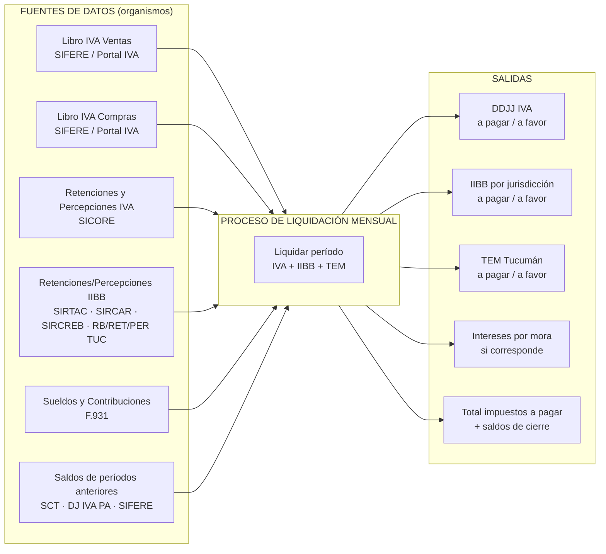
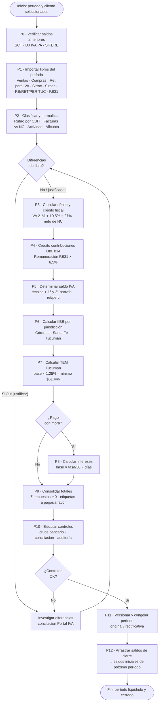

# Proceso de Liquidación Mensual — Vista de Procesos

> **Propósito:** capturar la lógica del archivo `demo-liquidacion-manual.xlsx` desde la **mirada de procesos** (actores, actividades, entradas, salidas, controles y flujo de trabajo), como complemento de la especificación técnica celda por celda (`especificacion-liquidacion-manual-excel.md`).
>
> Mientras la especificación técnica detalla *qué fórmula calcula qué celda*, este documento describe *qué hace el estudio contable, en qué orden y con qué controles*, para que el software replique el proceso completo, no solo el cálculo.

---

## 1. Ficha del proceso

| Atributo | Valor |
|---|---|
| **Nombre del proceso** | Liquidación mensual de impuestos |
| **Objetivo** | Determinar la posición fiscal mensual del cliente (IVA, IIBB y TEM) y emitir el detalle de impuestos a pagar o a favor |
| **Frecuencia** | Mensual (período calendario) |
| **Responsable** | Estudio contable (socio/contador + preparador + revisor) |
| **Cliente del proceso** | Contribuyente (p.ej. Distribuidora Brako S.R.L.) |
| **Impuestos cubiertos** | IVA (nacional), IIBB Convenio Multilateral (Córdoba, Santa Fe), TEM (Tucumán) |
| **Fuente de verdad actual** | Workbook Excel `demo-liquidacion-manual.xlsx` (25 hojas) |
| **Destino en el software** | Módulo fiscal de Contable (Puerta 3: liquidaciones) |

### 1.1 Actores y roles

| Actor | Rol en el proceso |
|---|---|
| **Sistema AFIP / organismos provinciales** | Proveen los libros SIFERE (ventas/compras), SICORE (retenciones IVA), SIRTAC/SIRCAR/SIRCREB (IIBB), F.931 (sueldos) |
| **Preparador** | Importa datos, carga comprobantes, concilia libros, corre el cálculo |
| **Revisor / Contador** | Valida resultados, autoriza el cierre, gestiona saldos y compensaciones |
| **Sistema Contable (app)** | Automatiza importación, cálculo, control, versionado y cierre del período |

---

## 2. Diagrama de contexto (entradas → proceso → salidas)



---

## 3. Cadena de valor del proceso

La lógica del Excel se puede leer como una **cadena de valor de 6 macro-actividades**, donde cada una consume el producto de la anterior:

```
┌──────────┐   ┌──────────┐   ┌──────────┐   ┌──────────┐   ┌──────────┐   ┌──────────┐
│ 1. Captura│ → │ 2. Clasi-│ → │ 3. Cálcu-│ → │ 4. Deter-│ → │ 5. Consol-│ → │ 6. Cierre │
│    y      │   │ ficación │   │ lo de    │   │ minación │   │ idación y│   │ y archivo│
│ importa- │   │ de datos │   │ impuestos│   │ del saldo│   │ controles│   │          │
│ ción     │   │          │   │          │   │          │   │          │   │          │
└──────────┘   └──────────┘   └──────────┘   └──────────┘   └──────────┘   └──────────┘
```

| # | Macro-actividad | Qué hace el estudio (hoy en Excel) | Entradas | Salidas |
|---|---|---|---|---|
| **1** | **Captura e importación** | Descarga los libros del Portal AFIP / organismos provinciales y los vuelca a las hojas `Ventas`, `Compras`, `Ret perc IVA`, `Sirtac`, `Sircar PER`, `RB/RET/PER TUC`, `F.931` | Libros SIFERE, SICORE, provinciales, F.931 | Libros cargados por período |
| **2** | **Clasificación y normalización** | Clasifica proveedores por rubro (`SUPER`/`TRANSPORTE`) mediante VLOOKUP sobre la tabla maestra `Base de Datos Compras`; separa facturas de notas de crédito; agrupa por actividad y alícuota | Libros cargados + tabla maestra de proveedores | Comprobantes clasificados por rubro, actividad y alícuota |
| **3** | **Cálculo de impuestos** | Calcula débito y crédito fiscal de IVA, crédito por contribuciones (Dto. 814), impuesto determinado de IIBB por jurisdicción y TEM | Datos clasificados + constantes (alícuotas, mínimos, coeficientes) | Débito, crédito, impuestos determinados |
| **4** | **Determinación de saldos** | Neta débitos contra créditos, aplica saldos de períodos anteriores, retenciones, percepciones y compensaciones; determina saldo técnico y resultado por impuesto | Impuestos calculados + saldos anteriores (SCT, DJ IVA PA, SIFERE) + ret/perc | Resultado por impuesto: **a pagar / a favor** |
| **5** | **Consolidación y control** | Calcula intereses si hay mora, suma los impuestos a pagar, y ejecuta controles de auditoría (cruce con Portal IVA, acreditaciones bancarias vs. facturado, diferencias de libro) | Resultados por impuesto + datos de conciliación | Total a pagar + reportes de control |
| **6** | **Cierre y archivo** | Congela el período, arrastra los saldos de cierre como saldos iniciales del mes siguiente, versiona la liquidación (original/rectificativa) y archiva la documentación | Resultados cerrados | Período cerrado + saldos iniciales del próximo + trazabilidad |

---

## 4. Desglose de actividades por macro-proceso

### 4.1 Captura e importación

| Actividad | Detalle | Hoja(s) del Excel |
|---|---|---|
| **Importar ventas** | Volcar el libro IVA ventas del período (comprobantes emitidos) | `Ventas` |
| **Importar compras** | Volcar el libro IVA compras del período (comprobantes recibidos) | `Compras` |
| **Importar retenciones IVA** | Volcar el detalle SICORE de retenciones y percepciones de IVA | `Ret perc IVA` |
| **Importar retenciones IIBB** | Volcar los detalle de SIRTAC (SF), SIRCAR (Cba), SIRCREB (CM) y Tucumán | `Sirtac`, `Sircar PER`, `SIRCREB`, `RB TUC`, `RET TUC`, `PER TUC` |
| **Importar sueldos** | Volcar el F.931 del período (remuneraciones y contribuciones) | `F.931` |
| **Cargar saldos iniciales** | Ingresar (o traer del cierre anterior) saldo técnico IVA, saldo a favor IVA y saldos de IIBB por jurisdicción | `SCT`, `DJ IVA PA`, `SIFERE` |

> **Control de entrada:** verificar que el período de todos los libros sea el mismo y que las fechas de comprobante pertenezcan al período.

### 4.2 Clasificación y normalización

| Actividad | Detalle | Hoja(s) |
|---|---|---|
| **Clasificar proveedores** | Asignar rubro (`SUPER`/`TRANSPORTE`) a cada compra según CUIT del proveedor; los no catalogados quedan marcados | `Compras` col. AH + `Base de Datos Compras` |
| **Separar facturas vs. notas de crédito** | Las NC (tipos 3/6/8) restan netos e IVA; se informan por separado | `Ventas`, `Compras` |
| **Agrupar por actividad** | Separar ventas/compras por actividad (transporte automotor, minimercados, otros) porque tributan IIBB de forma diferencial | `Ventas` filas 22-29, `Compras` filas 121-129 |
| **Agrupar por alícuota** | Separar netos e IVA por alícuota (21%, 10,5%, 27%) y por tipo de comprobante (A vs. B/CF) | `Ventas`, `Compras` |
| **Normalizar constancias** | Formatear CUIT (`00-00000000-0`) y constancias (`0000-00000000`) para su presentación | `Mis Retenc` cols. O-Q |

### 4.3 Cálculo de impuestos

| Actividad | Fórmula de negocio | Fuente |
|---|---|---|
| **Débito fiscal** | Σ IVA por alícuota de ventas (21% + 10,5% + 27%), neto de NC; separado por actividad | `IVA-IB-TEM` bloque DF |
| **Crédito fiscal** | Σ IVA por alícuota de compras (21% + 10,5% + 27%), neto de NC; + compras no gravadas para prorrata | `IVA-IB-TEM` bloque CF |
| **Crédito por contribuciones** | Remuneración neta F.931 × 6,5% (Dto. 814 / Art. 19 Ley 27.541) | `IVA-IB-TEM` filas 27-31 |
| **IIBB por jurisdicción** | Para cada jurisdicción activa: Σ(base por actividad × flag) → impuesto = base × alícuota | `IVA-IB-TEM` grilla 69-88 |
| **TEM** | Base (transporte + caña) × 1,25%, con mínimo de $61.446 | `IVA-IB-TEM` filas 98-113 |

### 4.4 Determinación de saldos

| Impuesto | Ecuación de saldo |
|---|---|
| **IVA** | Saldo técnico = débito − crédito − contribuciones − saldo técnico anterior; Resultado = saldo técnico − (saldo 2° párrafo + percepciones − restituciones + retenciones) |
| **IIBB** | Resultado = impuesto determinado − (percepciones + retenciones bancarias + retenciones + otros créditos + saldo anterior) |
| **TEM** | Resultado = max(impuesto, mínimo) − retenciones/percepciones |

**Reglas de negocio transversales:**

1. Si el resultado es **negativo** → queda "a favor" y se arrastra como saldo inicial del próximo período.
2. Si el resultado es **positivo** → queda "a pagar".
3. El total a pagar **solo suma los impuestos ≥ 0**; los "a favor" no netean el total.
4. Los saldos "1° párrafo" (técnico) y "2° párrafo" (libre disponibilidad) de IVA se tratan por separado y rotan entre períodos.

### 4.5 Consolidación y control

| Control | Qué valida | Fuente |
|---|---|---|
| **Diferencias de libro** | Total general vs. suma por alícuota (debe dar 0 o justificarse) | `IVA-IB-TEM` celdas D14/F14, D25/F25 |
| **Conciliación Portal IVA** | Débito/crédito del libro vs. valores declarados en el Portal IVA de AFIP | `AUDITOR` |
| **Cruce de acreditaciones** | Acreditaciones bancarias por banco vs. total facturado del libro | `Control de las acred.` |
| **Intereses por mora** | Base × (tasa mensual / 30) × días de atraso, si el pago vence después de la fecha de vencimiento | `IVA-IB-TEM` filas 91-94 |
| **Caja/imputaciones** | Cruce de caja mensual con ratios y ajustes | `CAJA FISCAL` |

### 4.6 Cierre y archivo

| Actividad | Detalle |
|---|---|
| **Versionar** | Marcar la liquidación como original o rectificativa (Rect 1, Rect 2, ...) |
| **Congelar** | Inmovilizar el cálculo del período cerrado (en la app: estado FINALIZED + hash, invariantes V-003/V-004) |
| **Arrastrar saldos** | Guardar resultados de cierre (a favor, saldo técnico, saldo IIBB) como saldos iniciales del próximo período |
| **Archivar** | Conservar la documentación de respaldo (libros, constancias, DDJJ) |

---

## 5. Puntos de decisión y excepciones

| Situación | Decisión / tratamiento |
|---|---|
| Proveedor sin rubro en la tabla maestra | Queda excluido de las retenciones de IIBB; requiere carga manual del rubro |
| Nota de crédito de percepción/retención | Importe negativo; netea el total de percepciones/retenciones |
| Resultado negativo | No se paga; pasa a saldo a favor del período siguiente |
| Pago después del vencimiento | Se calculan intereses por mora con la tasa de la jurisdicción |
| Saldo técnico IVA anterior | Entra como "saldo 1° párrafo"; el saldo a favor de libre disponibilidad como "2° párrafo" |
| Compensación de saldos | Se registra el "monto utilizado" (p.ej. $181.580,01 en junio 2026) |
| Diferencia de libro sin justificar | Se investiga antes de cerrar el período (bloqueante) |

---

## 6. Flujo de trabajo (workflow) — diagrama Mermaid

El siguiente diagrama captura el **flujo de trabajo completo** del proceso de liquidación mensual, tal como se ejecuta en el Excel y debe replicarse en la app:



### 6.1 Leyenda del flujo

| Nodo | Tipo | Descripción |
|---|---|---|
| `P0` – `P12` | Actividad | Paso del proceso (mapeado a las macro-actividades §3 y a la especificación técnica §7) |
| `D1` – `D3` | Decisión | Punto de control con desvío posible |
| `INV` | Actividad de remediación | Investigación de diferencias (bloqueante) |
| `INICIO` / `FIN` | Evento | Inicio y fin del proceso |

### 6.2 Correspondencia con la especificación técnica

| Paso del flujo | Sección en `especificacion-liquidacion-manual-excel.md` |
|---|---|
| P0 · Verificar saldos | §4.1–4.3 (SCT, DJ IVA PA, SIFERE) |
| P1 · Importar libros | §3 (Capa 1) |
| P2 · Clasificar | §3.1–3.3 (Ventas, Compras, Base de Datos Compras) |
| P3 · Débito/crédito | §5.1–5.2 |
| P4 · Dto. 814 | §5.3 |
| P5 · Saldo IVA | §5.5 |
| P6 · IIBB | §5.6 |
| P7 · TEM | §5.8 |
| P8 · Intereses | §5.7 |
| P9 · Totales | §5.9 |
| P10 · Controles | §6 (auditoría y control) |
| P11 · Versionar/congelar | §7 Paso 10 (invariantes V-003/V-004) |
| P12 · Arrastrar saldos | §7 Paso 10 y §10.3 |

---

## 7. KPI y métricas del proceso

| Métrica | Definición | Meta |
|---|---|---|
| **Tiempo de liquidación** | Desde la disponibilidad de libros hasta el cierre del período | Reducir vs. proceso manual |
| **Días de mora evitados** | Días entre vencimiento y pago cuando se calcula intereses | 0 días (proceso a tiempo) |
| **% de períodos sin diferencias** | Períodos donde D14/F14/D25/F25 = 0 | 100% con conciliación |
| **Exactitud del cálculo** | Conciliación contra DDJJ presentada | Sin desvíos |
| **Trazabilidad** | Períodos con versionado y saldos arrastrados correctos | 100% |

---

## 8. Referencias

- Especificación técnica celda por celda: [`especificacion-liquidacion-manual-excel.md`](./especificacion-liquidacion-manual-excel.md)
- Plan de desarrollo: [`PLAN_DESARROLLO_CONTABLE.md`](../PLAN_DESARROLLO_CONTABLE.md)
- Invariantes (V-001, V-003, V-004): [`invariantes.md`](./invariantes.md)
- Glosario: [`glosario.md`](./glosario.md)
- Runbooks del piloto: [`runbooks-piloto.md`](./runbooks-piloto.md)
